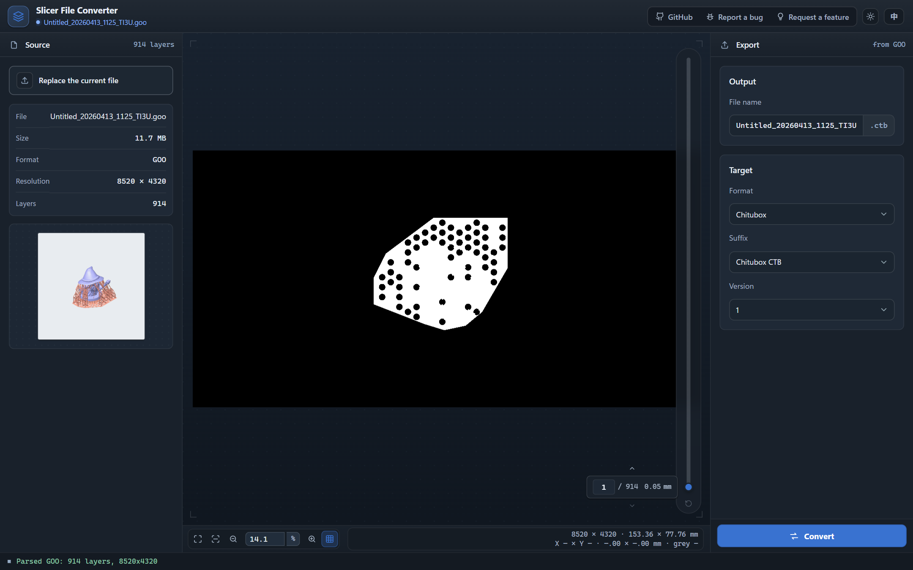

# slicer-converter

[English](README.md) | [简体中文](README.zh-CN.md)

Resin slicer file converter for MSLA and DLP printers. One Rust format registry drives the CLI and the browser WebAssembly build.

[](https://github.com/Innovgame/slicer-converter/actions/workflows/ci.yml)
[](LICENSE)

**This project is inspired by [UVtools](https://github.com/sn4k3/UVtools).** [UVtools](https://github.com/sn4k3/UVtools), maintained by [Tiago Conceição](https://github.com/sn4k3), is the public reference for reading, repairing, and converting resin slicer files. slicer-converter follows that line: detection, version matrices, archive layout, manifest and config fields, and RLE or PNG layer codecs are aligned with UVtools format behavior, then packaged as a Rust engine for the CLI and the browser. The code, runtime, and license are maintained independently. This repository is not affiliated with UVtools.



Version `0.1.3`. Download CLI binaries from [Releases](https://github.com/Innovgame/slicer-converter/releases) and check them with `SHA256SUMS`. Questions can go to [Discussions](https://github.com/Innovgame/slicer-converter/discussions). Creality CXDLP v1, v2, and v3 are import-only. See [CHANGELOG.md](CHANGELOG.md).

The live test page is at <https://innovgame.github.io/slicer-converter/>.

Install the CLI from Releases. The same tag publishes `@innovgame/slicer-converter` to GitHub Packages. npm receives the same build as `slicer-converter` when `NPM_TOKEN` is configured. For GitHub Packages, add this to `.npmrc`, then install:

```text
@innovgame:registry=https://npm.pkg.github.com
```

```bash
npm install @innovgame/slicer-converter
```

On npm, install the unscoped package instead:

```bash
npm install slicer-converter
```

## Contents

- [Relationship to UVtools](#relationship-to-uvtools)
- [What it does](#what-it-does)
- [Supported formats](#supported-formats)
- [Quick start](#quick-start)
- [Command line](#command-line)
- [Browser API](#browser-api)
- [Development](#development)
- [Documentation](#documentation)
- [Contributing](#contributing)
- [Acknowledgements](#acknowledgements)
- [License](#license)

## Relationship to UVtools

- The inspiration is UVtools' long-running public implementation of resin slicer formats.
- Alignment covers entry naming, manifest and config fields, version matrices, layer codecs, and archive layout. New or changed formats are compared with the matching UVtools implementation before they land in this repository.
- This repository is a registry-driven Rust core plus a CLI and WebAssembly build. The browser and the command line read the same format facts.
- UVtools uses [AGPL-3.0](https://github.com/sn4k3/UVtools/blob/master/LICENSE). This repository uses [MIT](LICENSE).

## What it does

- Converts between registered slicer formats. Import and export capability comes from the Rust registry.
- Parses, previews, and converts in the browser. WebAssembly runs locally, so conversion does not need a backend.
- Decodes and encodes layers as a stream, which keeps larger files workable.
- Detects a format from file bytes. The extension is a hint. When bytes are present, magic and version win over the extension.
- Uses SIMD128 for some RLE paths on wasm32.
- Uses Web Workers for parallel layer codecs, sized from the CPU count. A long conversion can be cancelled with `AbortSignal`.
- Previews a layer after a file is opened. The test page shows the first-layer thumbnail.

## Supported formats

`slicer-converter --help` and the browser `getSupportedFormats()` helper are the live extension lists. This table groups the current registry.

| Family                               | Extensions                                    | Import | Export      |
| ------------------------------------ | --------------------------------------------- | ------ | ----------- |
| Chitubox CTB                         | `.ctb`                                        | yes    | yes         |
| Chitubox CBDDLP                      | `.cbddlp` `.cbddlp-v1`                        | yes    | yes         |
| Anycubic Photon, Chitubox-compatible | `.photon`                                     | yes    | yes         |
| Chitubox PHZ                         | `.phz`                                        | yes    | yes         |
| Voxelab FDG                          | `.fdg`                                        | yes    | yes         |
| Anycubic PhotonS                     | `.photons`                                    | yes    | yes         |
| Chitubox Zip                         | `.zip`                                        | yes    | yes         |
| Elegoo GOO                           | `.goo`                                        | yes    | yes         |
| Phrozen PRZ                          | `.prz`                                        | yes    | yes         |
| Prusa SL1 / SL1S                     | `.sl1` `.sl1s`                                | yes    | yes         |
| Anycubic Photon Workshop             | listed below                                  | yes    | yes         |
| Anycubic Zip                         | `.pm4u` `.pm7` `.pm7m` `.pwsz` `.pp1` `.pp1m` | yes    | yes         |
| Voxeldance VDT                       | `.vdt`                                        | yes    | yes         |
| Creality CXDLPv4                     | `.cxdlpv4`                                    | yes    | yes         |
| Creality CXDLP v1 / v2 / v3          | `.cxdlp` `.v1.cxdlp`                          | yes    | import-only |

Notes:

- CTB covers v1–v5, including GKtwo profiles. Encrypted CTB v4 and v5 can also be imported and exported. The extension remains `.ctb`. Select a version with `--profile`, or use a versioned output name such as `model.v4.ctb`.
- The current GOO profile is GOO v3. PRZ reuses the GOO-family container and RLE shape and keeps its own format identity.
- SL1 and VDT are ZIP archives. Layers are PNG. Configuration is INI for SL1 and a JSON manifest for VDT.
- Anycubic binary files are split by machine profile. Choose the layout version with `--version`, for example `1`, `515`, `516`, `517`, or `518`.
- Creality CXDLP v1, v2, and v3 are import-only. CXDLPv4 can be imported and exported.
- `.zip` is only an extension hint for Chitubox Zip. The archive contents decide the format.

Anycubic Photon Workshop extensions: `.pw0` `.pws` `.pwx` `.dlp` `.pwmo` `.pwms` `.pwma` `.pwmx` `.pmsq` `.pm3` `.pm3m` `.dl2p` `.pmx2` `.pwmb` `.pm3r` `.pm3n` `.pm4n` `.px6s` `.pm5` `.pm5s` `.m5sp`.

## Quick start

Requirements: Rust stable, [wasm-pack](https://rustwasm.github.io/wasm-pack/installer/), Node.js 22 (the version CI uses), and pnpm 10+.

```bash
pnpm install
pnpm build:wasm
pnpm dev
```

`pnpm dev` builds release WASM first, then starts the `apps/slicer-app` test page. The release build avoids measuring conversion against a debug WASM build.

Useful outputs:

- `packages/slicer-wasm/lib/`: wasm-pack output and JavaScript glue
- `apps/slicer-app/dist/`: static test page from `pnpm build`

## Command line

Download a build from [Releases](https://github.com/Innovgame/slicer-converter/releases), or build it:

```bash
cargo build --manifest-path rust/Cargo.toml -p slicer-converter-cli --release
```

Binaries:

- Windows: `rust/target/release/slicer-converter.exe`
- Linux / macOS: `rust/target/release/slicer-converter`

```bash
# Try the included fixture first.
slicer-converter --input examples/sample.ctb --output sample.sl1

# Source format comes from file bytes. Target format comes from the output name.
slicer-converter --input sample.goo --output sample.ctb

# Select CTB v4 without relying on a version suffix in the file name.
slicer-converter --input sample.goo --output sample.ctb --profile ctb-v4

# Anycubic layout version
slicer-converter --input sample.goo --output sample.pwmx --version 1

# Print staged timings to stderr: read, transcode, assemble, write, total
slicer-converter --timing --input sample.goo --output sample.ctb
```

`--profile` accepts a profile id or alias, such as `ctb-v4`, `pwmx`, or `cxdlpv4`. `--threads <n>` overrides the layer transcode worker count.

On Windows, publish local artifacts with:

```powershell
pnpm build:cli:artifacts
```

That command builds the current Windows binary and, when WSL is available, Linux glibc and Linux musl binaries:

- `dist/windows/slicer-converter.exe`
- `dist/linux-glibc/slicer-converter`
- `dist/linux-musl/slicer-converter`

One platform:

```powershell
./scripts/build-cli-artifacts.ps1 -Windows
./scripts/build-cli-artifacts.ps1 -LinuxGlibc
./scripts/build-cli-artifacts.ps1 -LinuxMusl
```

macOS binaries are built on macOS. Intel and Apple Silicon produce `x86_64-apple-darwin` and `aarch64-apple-darwin`. Use `lipo` on macOS when you need a universal binary.

Tagged releases publish Windows, Linux glibc, Linux musl, and macOS Apple Silicon binaries through [Release](.github/workflows/release.yml). Each release includes `SHA256SUMS`. Intel macOS builds from source.

## Browser API

`@innovgame/slicer-converter` is the browser entry. Prefer the typed helpers. The wasm-bindgen ABI, including `parse_header`, `decode_layer`, and `encode_layer`, stays at the Rust and WASM boundary.

```ts
import {
    convertSlicerFile,
    decodeSlicerLayerPreview,
    openSlicerDocumentFile,
    parseBrowserFileHeader
} from "@innovgame/slicer-converter";

const document = await openSlicerDocumentFile({
    file,
    parseHeader: parseBrowserFileHeader
});

const preview = await decodeSlicerLayerPreview({
    document,
    layerIndex: 0,
    quality: "settled",
    maxPreviewSize: 1024
});

const result = await convertSlicerFile({
    file,
    target: "vdt",
    signal: abortController.signal,
    onProgress(progress) {
        console.log(progress.phase, progress.current, progress.total);
    }
});
```

Callers display `preview.bitmap` and download or save `result.blob`. The facade, worker, and archive helpers are documented in the [browser integration reference](docs/browser-integration-reference.md) and [packages/slicer-wasm/README.md](packages/slicer-wasm/README.md).

| Helper                     | Use                                                           |
| -------------------------- | ------------------------------------------------------------- |
| `convertSlicerFile`        | Convert a browser `File` or `Blob`                            |
| `openSlicerDocumentFile`   | Open a browser `File`; the extension comes from the file name |
| `decodeSlicerLayerPreview` | Decode one preview from an open document                      |
| `parseBrowserFileHeader`   | Parse a file header                                           |
| `getSupportedFormats`      | Read format facts from the Rust registry                      |

## Development

The repository is a pnpm workspace. Root scripts live at the top. Rust sources, Cargo manifests, and the Cargo cache live in `rust/`.

```text
package.json                 # workspace scripts
pnpm-workspace.yaml
rust/                        # core, wasm, and cli
packages/slicer-wasm/        # WASM package and browser facade
apps/slicer-app/             # Vite + React 19 test page
docs/                        # specs, architecture, and troubleshooting
```

- `rust/crates/core/`: codecs, registry, and transcode
- `rust/crates/wasm/`: wasm-bindgen exports
- `rust/crates/cli/`: command-line entry
- `packages/slicer-wasm/src/index.ts`: browser exports
- `apps/slicer-app/src/main.tsx`: test-page entry

The frontend workspace uses TypeScript 6.x and React 19.

```bash
pnpm check          # Prettier, ESLint, and TypeScript
pnpm test           # typecheck, Rust, WASM package unit tests, app unit tests, scripts
pnpm test:rust
pnpm test:wasm      # wasm-pack Node runner
pnpm test:browser   # WASM browser contract and Playwright e2e
pnpm test:full      # pnpm test plus pnpm test:browser
pnpm benchmark:rust
pnpm benchmark:app
pnpm fixtures       # refresh generated samples under rust/crates/core/tests/fixtures/
```

`pnpm benchmark:wasm:browser` runs the WASM SIMD microbenchmark. That harness currently returns throughput through panic text, so the command exits non-zero.

Real-file fast-path benchmarks accept `SC_REAL_GOO_PATH`, `SC_REAL_PRZ_PATH`, and `SC_REAL_CTB_PATH`. Optional `SC_REAL_LAYER_LIMIT`, or the matching `SC_REAL_GOO_LAYER_LIMIT`, `SC_REAL_PRZ_LAYER_LIMIT`, and `SC_REAL_CTB_LAYER_LIMIT`, limits the sampled layer count.

Pushes to `master`, and pull requests targeting `master`, run [CI](.github/workflows/ci.yml). CI covers lint, Rust tests and Clippy, frontend and script tests, wasm-pack, and Playwright cases that do not need a local UVtools install.

After CI succeeds on `master`, [Deploy to GitHub Pages](.github/workflows/deploy.yml) publishes the test page to <https://innovgame.github.io/slicer-converter/>. You can also run that workflow manually. Pages source must be GitHub Actions.

## Documentation

- [Documentation index](docs/README.md)
- [Troubleshooting / FAQ](docs/troubleshooting-faq.md)
- [Deployment runbook](docs/deployment-runbook.md)
- [Browser integration reference](docs/browser-integration-reference.md)
- [Adding a format](docs/adding-a-new-format.md)
- [Architecture diagrams](docs/architecture-diagrams.md)
- [Rust quickstart](docs/rust-quickstart.md)

Internal plans and agent notes stay in `docs/` and are not the user entry points.

## Contributing

See [CONTRIBUTING.md](CONTRIBUTING.md), [SECURITY.md](SECURITY.md), and [CODE_OF_CONDUCT.md](CODE_OF_CONDUCT.md).

## Acknowledgements

Thanks to [Tiago Conceição](https://github.com/sn4k3) and the [UVtools](https://github.com/sn4k3/UVtools) contributors. UVtools made resin slicer formats something this project can keep checking against.

## License

[MIT](LICENSE)
