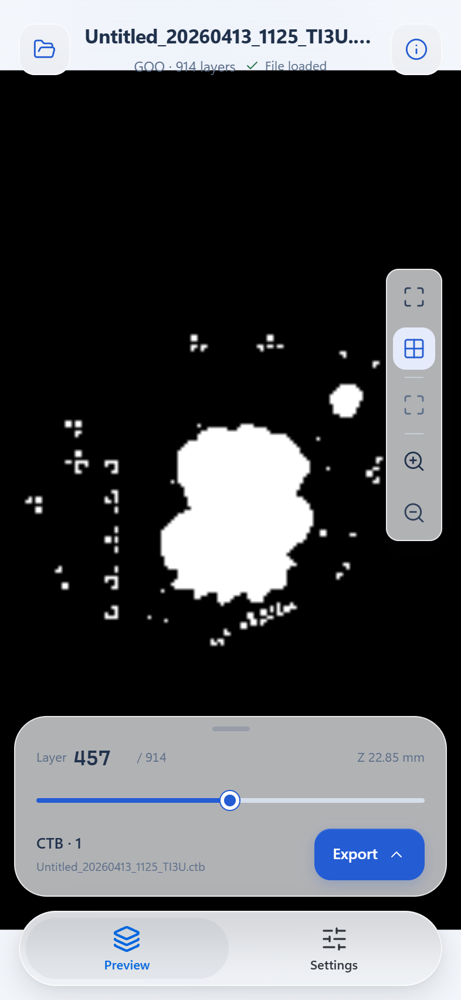
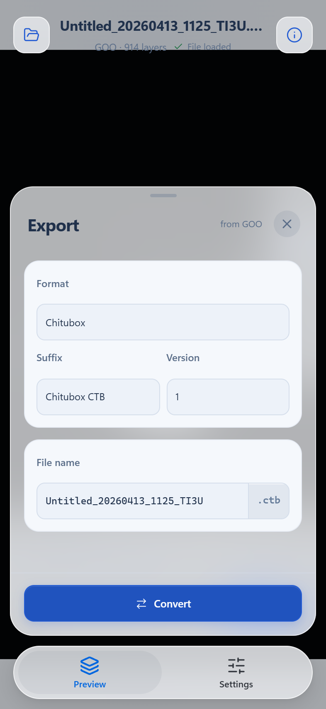
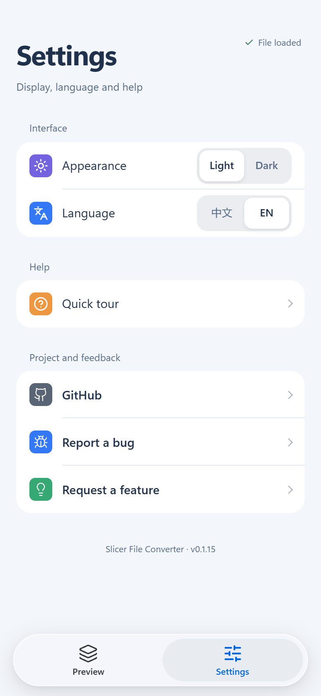

# slicer-converter

[English](README.md) | [简体中文](README.zh-CN.md)

Resin slicer file converter for MSLA and DLP printers. One Rust format registry drives the CLI and the browser WebAssembly build.

[](https://github.com/Innovgame/slicer-converter/actions/workflows/ci.yml)
[](https://www.npmjs.com/package/slicer-converter)
[](https://github.com/Innovgame/slicer-converter/releases)
[](LICENSE)

**This project is inspired by [UVtools](https://github.com/sn4k3/UVtools).** Format detection, version matrices, archive layout, manifest fields, and layer codecs are aligned with UVtools. This repository is an independent MIT-licensed Rust engine for conversion and preview. It is not affiliated with UVtools.


### Mobile interface

Open the [browser app](https://innovgame.github.io/slicer-converter/) on your phone to preview layers and convert files locally. The mobile interface includes floating frosted-glass navigation, file and export drawers, and iOS-style settings.

<p>
  
  
  
</p>

Use pinch gestures or the preview tools to zoom, drag to pan, and move the layer slider to inspect the print. The header keeps the current status visible; tap it for details. The Preview and Settings tabs preserve the loaded file and export choices. Tablets retain the larger workbench with a centered touch slider.

## Install

Version `0.1.15`. Questions can go to [Discussions](https://github.com/Innovgame/slicer-converter/discussions). Changes are in [CHANGELOG.md](CHANGELOG.md).

### CLI

Download a binary from [Releases](https://github.com/Innovgame/slicer-converter/releases). Each release includes `SHA256SUMS`.

```bash
sha256sum -c SHA256SUMS
```

On Windows, compare the file hash with the matching line in `SHA256SUMS`:

```powershell
Get-FileHash .\slicer-converter-windows-x86_64.exe -Algorithm SHA256
```

### npm

```bash
npm install slicer-converter
```

```ts
import { initSlicerConverter } from "slicer-converter";

const api = await initSlicerConverter();
const formats = api.getSupportedFormats();
```

Call `initSlicerConverter()` before any other API function. In Node, the package reads the bundled wasm file. In the browser, it loads that file with `fetch`.

### GitHub Packages

Add this to `.npmrc`, then install `@innovgame/slicer-converter`:

```text
@innovgame:registry=https://npm.pkg.github.com
```

```bash
npm install @innovgame/slicer-converter
```

Import that package from `@innovgame/slicer-converter`. The API is the same.

## Quick start

After you download a Release binary, run it with your own slicer file. On Windows:

```powershell
.\slicer-converter-windows-x86_64.exe --input your-file.goo --output your-file.ctb
```

On Linux or macOS, mark the binary executable and use the matching file name:

```bash
chmod +x ./slicer-converter-linux-x86_64
./slicer-converter-linux-x86_64 --input your-file.goo --output your-file.ctb
```

macOS Apple Silicon uses `slicer-converter-macos-aarch64`. The source format comes from the file bytes. The target format comes from the output name.

If you cloned this repository, `examples/sample.ctb` is a tiny fixture for a first run. It is not a printable model.

```bash
slicer-converter --input examples/sample.ctb --output sample.sl1
```

The browser test page is at <https://innovgame.github.io/slicer-converter/>.

## Limits

- Creality CXDLP v1, v2, and v3 are import-only. CXDLPv4 can be imported and exported.
- Release binaries cover Windows, Linux glibc, Linux musl, and macOS Apple Silicon. Intel macOS builds from source.
- Node and the browser both need `initSlicerConverter()` before conversion or preview calls.

## What it does

- Converts between registered slicer formats. The Rust registry decides which profiles can be imported and exported.
- Parses, previews, and converts in the browser. WebAssembly runs locally, so conversion does not need a backend.
- Detects a format from file bytes. The extension is a hint. When bytes are present, magic and version win over the extension.
- Decodes and encodes layers as a stream, and can cancel a long conversion with `AbortSignal`.

## Supported formats

`slicer-converter --help` and `getSupportedFormats()` are the live extension lists. This table groups the current registry.

| Family                               | Extensions                                    | Import | Export      |
| ------------------------------------ | --------------------------------------------- | ------ | ----------- |
| Chitubox CTB                         | `.ctb`                                        | yes    | yes         |
| Chitubox CBDDLP                      | `.cbddlp` `.cbddlp-v1`                        | yes    | yes         |
| Anycubic Photon, Chitubox-compatible | `.photon`                                     | yes    | yes         |
| Chitubox PHZ                         | `.phz`                                        | yes    | yes         |
| Voxelab FDG                          | `.fdg`                                        | yes    | yes         |
| Anycubic PhotonS                     | `.photons`                                    | yes    | yes         |
| Chitubox Zip                         | `.zip`                                        | yes    | yes         |
| Elegoo GOO                           | `.goo`                                        | yes    | yes         |
| Phrozen PRZ                          | `.prz`                                        | yes    | yes         |
| Prusa SL1 / SL1S                     | `.sl1` `.sl1s`                                | yes    | yes         |
| Anycubic Photon Workshop             | listed below                                  | yes    | yes         |
| Anycubic Zip                         | `.pm4u` `.pm7` `.pm7m` `.pwsz` `.pp1` `.pp1m` | yes    | yes         |
| Voxeldance VDT                       | `.vdt`                                        | yes    | yes         |
| Creality CXDLPv4                     | `.cxdlpv4`                                    | yes    | yes         |
| Creality CXDLP v1 / v2 / v3          | `.cxdlp` `.v1.cxdlp`                          | yes    | import-only |

Notes:

- CTB covers v1–v5, including GKtwo profiles. Encrypted CTB v4 and v5 can also be imported and exported. The extension remains `.ctb`. Select a version with `--profile`, or use a versioned output name such as `model.v4.ctb`.
- The current GOO profile is GOO v3. PRZ reuses the GOO-family container and RLE shape and keeps its own format identity.
- SL1 and VDT are ZIP archives. Layers are PNG. Configuration is INI for SL1 and a JSON manifest for VDT.
- Anycubic binary files are split by machine profile. Choose the layout version with `--version`, for example `1`, `515`, `516`, `517`, or `518`.
- `.zip` is only an extension hint for Chitubox Zip. The archive contents decide the format.

Anycubic Photon Workshop extensions: `.pw0` `.pws` `.pwx` `.dlp` `.pwmo` `.pwms` `.pwma` `.pwmx` `.pmsq` `.pm3` `.pm3m` `.dl2p` `.pmx2` `.pwmb` `.pm3r` `.pm3n` `.pm4n` `.px6s` `.pm5` `.pm5s` `.m5sp`.

## Command line

```bash
# Source format comes from file bytes. Target format comes from the output name.
slicer-converter --input sample.goo --output sample.ctb

# Select CTB v4 without relying on a version suffix in the file name.
slicer-converter --input sample.goo --output sample.ctb --profile ctb-v4

# Anycubic layout version
slicer-converter --input sample.goo --output sample.pwmx --version 1
```

`--profile` accepts a profile id or alias, such as `ctb-v4`, `pwmx`, or `cxdlpv4`. `--threads <n>` overrides the layer transcode worker count. `--timing` prints staged timings to stderr.

Build from source:

```bash
cargo build --manifest-path rust/Cargo.toml -p slicer-converter-cli --release
```

Local multi-platform CLI artifacts are documented in the [deployment runbook](docs/deployment-runbook.md).

## Browser and Node API

Install `slicer-converter` from npm, or `@innovgame/slicer-converter` from GitHub Packages. Prefer the typed helpers. The wasm-bindgen ABI stays at the Rust and WASM boundary.

```ts
import {
    convertSlicerFile,
    decodeSlicerLayerPreview,
    initSlicerConverter,
    openSlicerDocumentFile,
    parseBrowserFileHeader
} from "slicer-converter";

await initSlicerConverter();

const document = await openSlicerDocumentFile({
    file,
    parseHeader: parseBrowserFileHeader
});

const preview = await decodeSlicerLayerPreview({
    document,
    layerIndex: 0,
    quality: "settled",
    maxPreviewSize: 1024
});

const result = await convertSlicerFile({
    file,
    target: "vdt",
    signal: abortController.signal,
    onProgress(progress) {
        console.log(progress.phase, progress.current, progress.total);
    }
});
```

Callers display `preview.bitmap` and download or save `result.blob`. More helpers are documented in the [browser integration reference](docs/browser-integration-reference.md) and [packages/slicer-wasm/README.md](packages/slicer-wasm/README.md).

| Helper                     | Use                                                           |
| -------------------------- | ------------------------------------------------------------- |
| `initSlicerConverter`      | Load the bundled wasm module                                  |
| `convertSlicerFile`        | Convert a browser `File` or `Blob`                            |
| `openSlicerDocumentFile`   | Open a browser `File`; the extension comes from the file name |
| `decodeSlicerLayerPreview` | Decode one preview from an open document                      |
| `parseBrowserFileHeader`   | Parse a file header                                           |
| `getSupportedFormats`      | Read format facts from the Rust registry                      |

## Development

Requirements: Rust stable, [wasm-pack](https://rustwasm.github.io/wasm-pack/installer/), Node.js 22, and pnpm 10+.

```bash
pnpm install
pnpm build:wasm
pnpm dev
```

`pnpm dev` builds release WASM first, then starts the `apps/slicer-app` test page.

```bash
pnpm check
pnpm test
pnpm test:rust
pnpm test:wasm
pnpm test:browser
pnpm test:full
```

Pushes to `master`, and pull requests targeting `master`, run [CI](.github/workflows/ci.yml). After CI succeeds on `master`, [Deploy to GitHub Pages](.github/workflows/deploy.yml) publishes the test page.

The repository layout:

- `rust/crates/core/`: codecs, registry, and transcode
- `rust/crates/wasm/`: wasm-bindgen exports
- `rust/crates/cli/`: command-line entry
- `packages/slicer-wasm/`: browser and Node facade
- `apps/slicer-app/`: Vite + React 19 test page

## Documentation

- [Documentation index](docs/README.md)
- [Troubleshooting / FAQ](docs/troubleshooting-faq.md)
- [Deployment runbook](docs/deployment-runbook.md)
- [Browser integration reference](docs/browser-integration-reference.md)
- [Adding a format](docs/adding-a-new-format.md)
- [Architecture diagrams](docs/architecture-diagrams.md)
- [Rust quickstart](docs/rust-quickstart.md)

Maintainer notes live in `docs/internal/` and are not the usage guide.

## Contributing

See [CONTRIBUTING.md](CONTRIBUTING.md), [SECURITY.md](SECURITY.md), and [CODE_OF_CONDUCT.md](CODE_OF_CONDUCT.md).

## Acknowledgements

Thanks to [Tiago Conceição](https://github.com/sn4k3) and the [UVtools](https://github.com/sn4k3/UVtools) contributors. UVtools made resin slicer formats something this project can keep checking against.

## License

[MIT](LICENSE)
