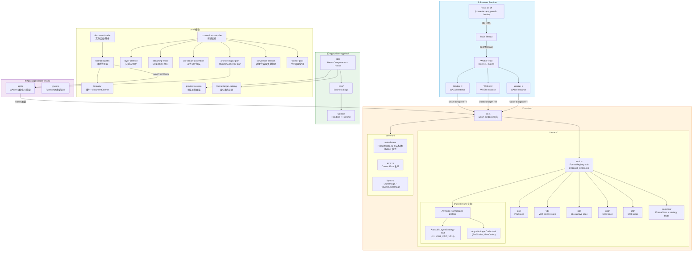
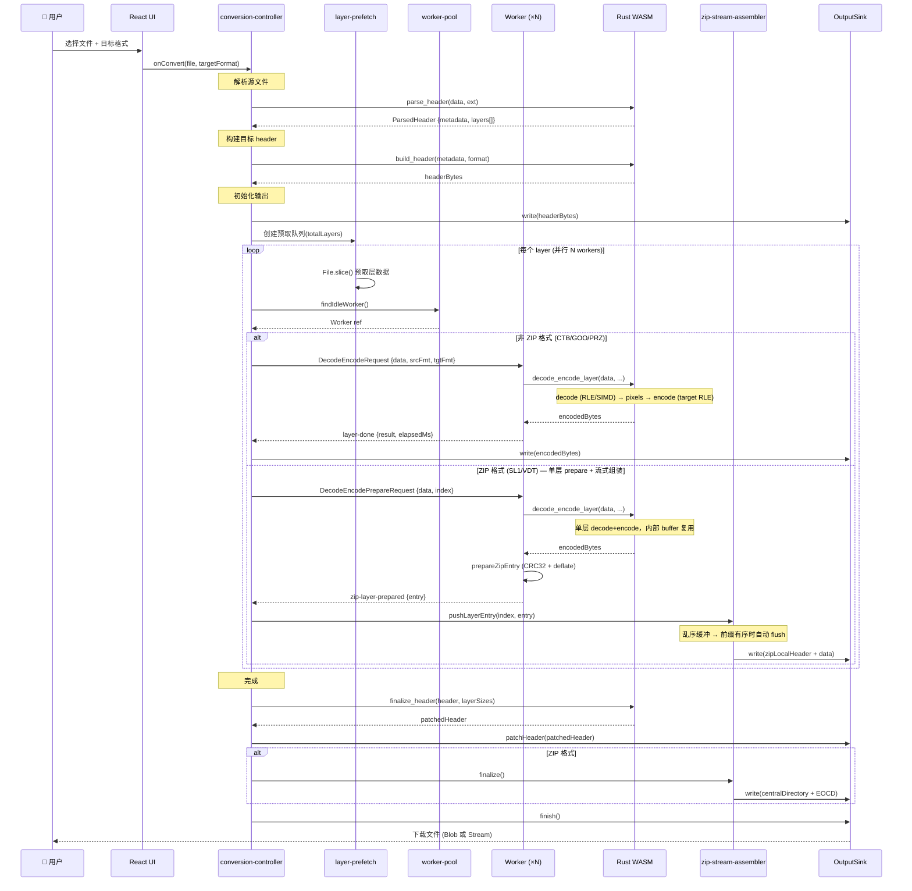
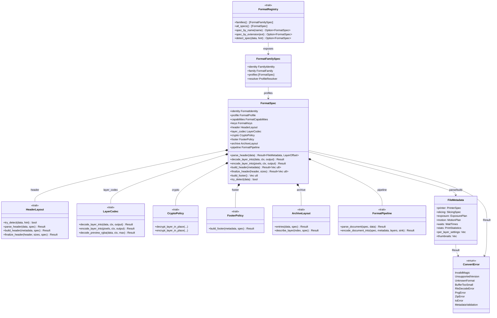

# 项目架构图

## 1. 项目架构总览

补充说明：

- 源文件加载优先经 `document-loader` 与格式插件的 `documentOpener` 处理；只有通用路径才回退到 WASM 头部解析。
- ZIP 输出的 entry naming、metadata entries 和 compression method 经 `archive-output-plan` 从 Rust/WASM 获取，浏览器侧只负责流式写出。
- Rust/WASM 已是格式事实的主来源，但浏览器侧当前仍保留 `KNOWN_FORMAT_INFOS` 作为启动期预热回退。
- worker 侧通过 `createWorkerRuntime(deps)` 组合 preview / conversion handler map，主线程只依赖消息协议，不直接耦合具体处理实现。

---

## 2. 格式转换完整数据流

---

## 3. Rust FormatSpec 与策略组合关系

