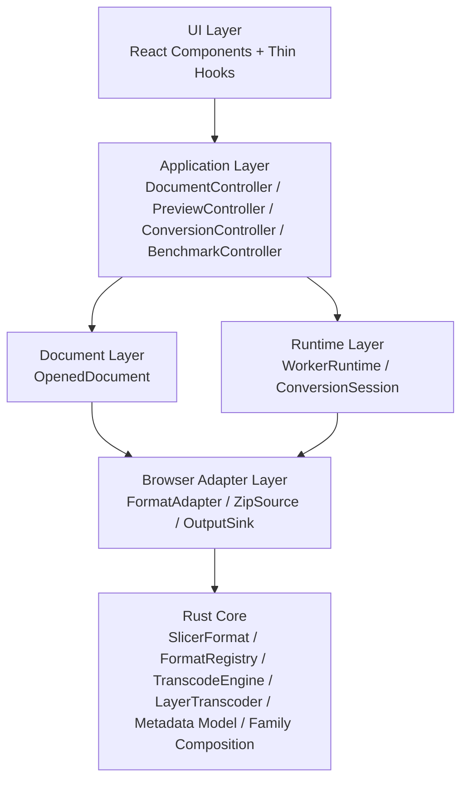

# Slicer-Converter 系统演进说明（断裂式重构版）

> 版本：2026-04-18  
> 目标：在接口可以直接断裂式替换的前提下，为项目规划下一阶段系统演进。  
> 关注维度：易拓展性 / 性能 / 面向对象封装 / 多态 / 组合优于继承 / 面向接口编程。  
> 取舍前提：不考虑向后兼容、老版本回退、渐进灰度；旧实现可以一次性删除，不保留 shim / alias。
>
> 本文是新增文档，不替代 [`docs/architecture-improvement-plan.md`](./architecture-improvement-plan.md)。  
> 前者记录第一轮收敛式改进；本文定义第二轮结构性升级的目标态。

---

## 0. 文档定位

这份文档不是“继续列一批优化点”，而是基于以下事实重新定义系统升级方向：

- 第一轮重构已经解决了很多真实热点，例如 ZIP 路径 streaming、batch transcode、`FileMetadata` concern split、Anycubic 家族组合化、前端 `FormatPlugin` 正式化。
- 当前系统仍然存在显著的结构性问题，例如胖 controller、双事实源 registry、worker/WASM 扁平参数协议、ZIP 与非 ZIP 路径在应用层泄漏。
- 既然本轮允许 breaking change，就不应该继续用兼容思维“缝补现状”，而应该直接把核心边界改成适合长期演进的形状。

本文还吸收了对 `UVtools` 仓库 `/Users/recholee/Documents/GitHub/UVtools` 的源码观察，但不会照搬其具体实现形状。  
吸收的是其经长期演化后证明有效的原则，不是其历史包袱。

---

## 1. 综合评估后的结论

### 1.1 第一轮已经做对了什么

第一轮最重要的成果，不是“做了很多优化”，而是证明了以下方向成立：

- 格式能力应该尽量靠近格式本身，而不是堆在中央控制流里。
- 热路径性能优化必须落到真实数据通路里，而不是停留在抽象层口号。
- `FileMetadata` 这类高耦合对象需要 concern split，逐层编码上下文要尽量避免 clone。
- Anycubic 这类格式家族适合走组合化，而不是继续扩写平铺分支。

### 1.2 当前系统最核心的结构问题

结合现有源码，第二轮需要真正解决的是这几件事：

1. `apps/slicer-app/src/app/hooks/use-converter-controller.ts` 仍然承担了过多职责，应用层边界太宽。
2. 前端 registry 同时依赖 built-in plugin 和 WASM 返回的 format info，再做一次 merge，`apps/slicer-app/src/core/format-registry.ts` 还不是单一事实源。
3. `apps/slicer-app/src/core/file-loader.ts` 中的 `ParsedFileState` 通过多个 nullable 字段描述一种“已打开文件”，数据聚合对象缺位。
4. worker 协议虽然已经从 `if/else` 走向 typed handler map，但 `apps/slicer-app/src/worker.ts` 仍然是扁平消息 + 扁平 WASM 调用模式。
5. Rust `SlicerFormat` + `FormatRegistry` 已经基本建立了格式中心边界，`list_supported_formats()` 也已经在向前端输出格式事实；但浏览器侧仍在 `syncFormatRegistryFromWasm()` 中做 merge，还没有围绕“文档对象”和“转换会话”形成稳定模型。
6. `apps/slicer-app/src/app/hooks/use-benchmark-controller.ts` 仍然独立持有 `fileBytesRef` / `fileExtensionRef` 并自行解析 header，说明 benchmark 还没有接入共享文档模型。

### 1.3 对上一版演进文档的最终判断

上一版文档的大方向是对的，但中段确实存在过度设计，主要表现在：

- 同时引入过多对象层次，如 `Job`、`Planner`、`CapabilityResolver`、`RuntimePool`、`RuntimeSession`。
- 同时定义 Rust `FormatDefinition` 和 TS `FormatCapabilityPack`，与“单一事实源”目标冲突。
- 过早把 `InputSource` / `OutputAssembler` 做成顶层统一抽象，而没有保留 ZIP/container 差异在格式家族内部消化的空间。
- 把缓存、session、adapter、planner 一次性都升格为一级架构概念，超出了当前仓库真实需要。

第二轮文档应当收紧：保留战略目标，减少概念数量，把升级路径落到更贴近真实代码边界的对象上。

---

## 2. 从 UVtools 吸收的原则

对 `UVtools` 源码的观察，最有价值的不是“它有哪些类”，而是它最终稳定下来的重心。

### 2.1 领域内核拥有事实源

`UVtools` 的格式列表、扩展名、文件判定、按路径/扩展名打开文件，主要集中在 `UVtools.Core/FileFormats/FileFormat.cs`。  
这说明成熟工具通常把“什么格式存在、怎么识别、它拥有什么能力”放在核心领域层，而不是放在 UI 层重复定义。

对本项目的启发：

- Rust `SlicerFormat` / `FormatRegistry` / `FormatIdentity` 应成为格式能力的唯一主事实源。
- TS 侧只保留浏览器专属的补充适配，不再定义一套与 Rust 对等的完整 capability 模型。

### 2.2 文档对象比零散状态更稳定

`UVtools` 打开文件后，后续预览、操作、问题检测都围绕具体 `FileFormat` 实例工作，而不是把“已打开文件”拆成多份游离状态。  
这对我们非常关键，因为当前 `parsedHeader`、`fileBytes`、`zipEntries`、`zipSource` 仍然分散在 hook 和 helper 里。

对本项目的启发：

- 第二轮最该先引入的一级对象，不是 `Planner`，而是 `OpenedDocument`。

### 2.3 缓存应是具体对象，不是先抽平台

`UVtools` 的 `UVtools.UI/LayerCache.cs` 很具体，只解决图层缓存与显示问题。  
这说明缓存最好先围绕已经被证明有收益的热点收敛，而不是一开始设计一个统一缓存框架。

对本项目的启发：

- 继续保留 inflate scratch、encode buffer pool、worker canvas pool 这些具体对象；preview 不再保留跨层 bitmap LRU。
- 不提前抽象出“大而全”的 cache subsystem。

### 2.4 差异留在最靠近差异的地方

`UVtools` 的 ZIP 家族没有先升成一个顶层万能容器框架；`SL1File`、`VDTFile`、`ChituboxZipFile`、`GenericZIPFile` 各自表达自己的容器行为。  
这说明真正复杂的 container/header/manifest 差异，应该优先留在格式家族内部处理。

对本项目的启发：

- ZIP 与非 ZIP 的差异不应过早上升成应用层的统一抽象。
- 统一点应该是“文档对象”和“转换会话”，不是“所有格式共享同一个最薄的 I/O 接口”。

### 2.5 不照搬 UVtools 的历史形状

`UVtools` 也存在很重的 UI 与很厚的核心基类。  
这不意味着我们要照搬“巨型 MainWindow”或“超厚 FileFormat 基类”，而是说明成熟工具也会保留很多历史包袱。

对本项目的启发：

- 吸收其原则，不复制其体量。
- 我们仍然应该继续拆胖 hook，并维持 Rust trait 边界的清晰性。

---

## 3. 第二轮的总体目标

第二轮不是追求“更抽象”，而是追求“更稳定的边界”。

### 3.1 这轮只围绕四个收敛点推进

1. 单一格式事实源  
   Rust 核心拥有格式身份、能力与检测信息。
2. 已打开文档对象  
   前端对“打开的文件”形成稳定聚合对象，停止在应用层散布 ZIP/raw 状态。
3. 热路径转换会话  
   先把 batch convert 这条最重路径收口为 session 模式。
4. 薄应用层  
   hook / controller 只编排 use case，不再直接拼 worker request 与格式分支。

### 3.2 明确不追求的东西

- 不追求一开始就抽出完整的 planner/runtime framework。
- 不追求让 preview / convert / benchmark 三条链路在第一步就完全统一。
- 不追求把 ZIP / 非 ZIP 差异完全抹平。
- 不追求用更多术语替代当前问题本身。

---

## 4. 六个维度的设计准则

| 维度         | 当前问题                                                 | 第二轮设计准则                                                             | 反模式                                             |
| ------------ | -------------------------------------------------------- | -------------------------------------------------------------------------- | -------------------------------------------------- |
| 易拓展性     | 新格式仍容易牵动 controller / registry / worker 多处修改 | 新增格式主要改 Rust 格式实现，TS 仅在需要浏览器特化时补 `FormatAdapter`    | 为一个格式同时改多份表、多份分支、多份协议         |
| 性能         | 热路径仍有扁平参数重复传输，ZIP/container 语义在高层泄漏 | 先把 batch convert 收口成 session；缓存和 pool 保持为具体小对象            | 为了“统一抽象”牺牲容器语义和零拷贝路径             |
| 面向对象封装 | 已打开文件状态分裂，hook 看到太多底层细节                | 引入 `OpenedDocument`；应用层不再直接处理 ZIP/raw 读取细节                 | 大量 nullable 状态 + ref + helper 拼出一个逻辑对象 |
| 多态         | 多态有进展，但浏览器侧仍偏配置对象 + 选填 hook           | 多态主要体现在 Rust `SlicerFormat`、格式家族组合件、TS `FormatAdapter`     | 把“可选 hook 集合”误当成完整多态模型               |
| 组合优于继承 | Anycubic 已走对，但其他家族还没系统化                    | 继续在格式家族内部做组合，不引入庞大继承树                                 | 为了统一而抽出万能父类                             |
| 面向接口编程 | 现在更需要稳定边界，而不是接口数量                       | 保留少量高价值接口：`OpenedDocument`、`FormatAdapter`、`ConversionSession` | 每一层都先抽接口，再决定对象到底是什么             |

---

## 5. 目标架构

### 5.1 修订后的分层



### 5.2 每层只负责什么

- UI Layer  
  只处理交互、状态展示、文件选择、结果展示。
- Application Layer  
  编排“打开文件”“请求预览”“执行转换”“运行 benchmark”这些 use case。
- Document Layer  
  表达一个已打开文件的完整上下文。
- Browser Adapter Layer  
  承载浏览器专属能力，例如 ZIP 懒读取、streaming header parse、下载/stream sink。
- Runtime Layer  
  承载 worker 调度、batch convert、热路径 buffer 复用。
- Rust Core  
  表达单格式能力、pairwise transcode 能力、元数据、解码/编码、header/finalize、家族组合件。

### 5.3 这版架构与上一版的区别

- 去掉了单独的 `Planning Layer`。
- 不再把 `InputSource` / `OutputAssembler` 升为顶层统一抽象。
- 不再让 TS 与 Rust 各自拥有一套完整 capability 模型。
- 把中心概念收敛为 `OpenedDocument`、`FormatAdapter`、`ConversionSession` 三类对象。

---

## 6. 核心对象模型

### 6.1 Rust：格式能力的唯一主事实源

Rust 核心继续以 `SlicerFormat` + `FormatRegistry` 为中心。
第二轮不重写这层，而是在现有 registry + trait 基础上继续收敛“家族能力”和“格式身份”：

- `FormatIdentity`
- `FormatRegistry::by_name` / `by_extension` / `detect` / `all`
- `parse_header`
- `decode_layer` / `decode_layer_into`
- `decode_layer_preview_rgba`
- `encode_layer` / `encode_layer_into`
- `build_header` / `finalize_header`

这里需要额外明确一个边界：

- `SlicerFormat` 只表达**单格式能力**
- pairwise fast path 不应继续塞进 `SlicerFormat`
- 未来像 `goo -> ctb`、`ctb -> goo` 这类“格式对级别”的优化路径，应统一收敛到独立的 `transcode` 层
- 该层的最终目标形态采用方案 C：`TranscodeEngine` 作为唯一入口，`LayerTranscoder` 作为 pairwise 策略接口，未命中或不适用时统一回退到 fallback

这意味着：

- `SlicerFormat` 负责格式自身的 parse / decode / encode / finalize
- `TranscodeEngine` 负责 source × target 之间的 pairwise transcode capability

关于这部分的专门设计，见 [`docs/fast-path-architecture.md`](./fast-path-architecture.md)。

这层应继续作为：

- 格式名、别名、扩展名的唯一主事实源
- ZIP 与非 ZIP 能力的主判定来源
- 可支持 preview fast path / batch convert / finalize header 的主能力来源
- `list_supported_formats()` 向前端导出只读格式事实的唯一来源

### 6.2 TS：仅保留浏览器侧 `FormatAdapter`

TS 不再定义与 Rust 对等的完整 capability 包，而只保留浏览器专属适配：

```ts
interface OpenedDocumentSource {
    readonly parsedHeader: ParsedHeader;
    readonly layerSource: LayerSource;
}

type LayerSource =
    | { kind: "raw-file"; file: File }
    | { kind: "raw-bytes"; bytes: Uint8Array }
    | { kind: "zip"; entries: ZipEntryInfo[]; zipSource: ZipSource };

interface FormatAdapter {
    readonly format: string;
    readonly openDocumentSource?: (file: File) => Promise<OpenedDocumentSource>;
}
```

ZIP 输出的 metadata entry / layer entry 命名策略不再作为 TS adapter hook 存在；它属于 Rust `ArchiveLayout`，通过 WASM 的 archive entry plan API 暴露给浏览器流式 ZIP writer。

设计原则：

- `FormatAdapter` 只表达浏览器侧特有行为。
- Rust 已经能表达的事实，不在 TS 重复定义。
- 没有浏览器特化需求的格式，不需要定义 adapter。
- `file-loader` / DocumentService 负责把 `OpenedDocumentSource` 组装成 `OpenedDocument`；adapter 只负责 source-specific 加载行为。
- 更贴近当前代码的落地方式，是把今天 `FormatPlugin` 里 `aliases` / `extensions` / `isZip` 这类事实字段删除，改为“Rust 格式事实表 + TS adapter map”两张表，而不是继续在 `syncFormatRegistryFromWasm()` 中做 mutable merge。

### 6.3 前端一级对象：`OpenedDocument`

当前前端最缺的，不是 planner，而是一个稳定的“已打开文件”对象。

```ts
interface OpenedDocument {
    readonly sourceFile: File;
    readonly parsedHeader: ParsedHeader;
    readonly adapter?: FormatAdapter;
    readLayerBytes(index: number): Promise<Uint8Array>;
    readCompressedLayer?(index: number): Promise<CompressedLayer>;
}

interface CompressedLayer {
    readonly bytes: Uint8Array;
    readonly compressionMethod: number;
    readonly uncompressedSize: number;
}
```

这个对象的内部仍然可以组合 `raw-file` / `raw-bytes` / `zip` 三类 source，但这种差异不应再泄漏到应用层。

它应取代现在分散在 hook/ref/helper 中的状态与行为：

- `parsedHeader`
- `fileBytes`
- `zipEntries`
- `zipSource`
- `sourceFile`
- `getLayerData()`
- `getZipLayerCompressed()`

收益：

- 面向对象封装更清晰。
- 应用层不再需要手动协调 ZIP/raw 的多份状态，也不再直接判断走哪条读取 helper。
- preview / convert 可以先围绕同一个文档对象工作；benchmark 是否并入共用文档模型，在后续里程碑再做收益判断。

### 6.4 热路径对象：`ConversionSession`

第二轮 session 化只先覆盖 batch convert 热路径：

```ts
type ConversionLayerInput =
    | { kind: "raw"; bytes: Uint8Array }
    | {
          kind: "zip";
          compressed: Uint8Array;
          compressionMethod: number;
          uncompressedSize: number;
      };

interface ConversionSession {
    readonly sourceFormat: string;
    readonly targetFormat: string;
    convertLayer(index: number, input: ConversionLayerInput): Promise<Uint8Array>;
    convertBatch(batch: readonly { index: number; input: ConversionLayerInput }[]): Promise<Uint8Array[]>;
    close(): Promise<void>;
}
```

它的职责是：

- 固定 source/target format、尺寸、layer metadata、AA/encryption 等上下文
- 让 worker/WASM 在一个会话内复用参数和 buffer
- 在 session 内部屏蔽 raw-source 与 zip-source 的 worker request 差异
- 为 batch convert 提供稳定入口

基于当前代码，这里的“统一”应理解为统一 session 入口，而不是强行让底层实现一步到位完全一致：

- raw-source 仍走单层 `decode_encode_layer` 并行路径
- zip-source 初版允许保留逐层 inflate / convert 路径
- 真正需要统一的是 controller 调用面，而不是两条链路必须立即共用同一条底层 batch 算法

它不负责：

- 文档打开
- 预览总流程
- benchmark UI 编排

### 6.5 具体小对象继续保留

以下对象不需要被“框架化”，但应继续保留并收敛职责：

- progressive preview queue / worker canvas pool
- encode buffer pool
- inflate scratch / compressed payload helper
- streaming sink / blob sink

这些对象是性能能力的承载体，但不应被包装成一个统一缓存平台。

---

## 7. 组合优于继承：格式家族升级方式

### 7.1 家族内部继续做组合

这一点要继续强化，但不需要扩张成庞大抽象体系。

优先处理三类家族：

- Anycubic 家族  
  继续沿 codec + layout 组合方向演进。
- ZIP 家族  
  在家族内部处理 manifest/header/layer naming/container finalize 等差异。
- RLE 家族  
  在家族内部共享 decode/preview fast path 与 encode buffer 复用。

### 7.2 不做的事情

- 不引入新的大型格式继承树。
- 不抽象“万能 container strategy framework”。
- 不要求所有格式都必须拆成同样数量的组合件。

### 7.3 成功标准

如果新增一个 ZIP 格式时，主要工作仍然是：

- Rust 侧新增格式实现或家族组合件
- TS 侧只补极少量浏览器适配
- 不需要改 controller 主流程

那就说明“组合优于继承”在本项目里真正成立了。

---

## 8. 面向接口编程：只保留高价值接口

第二轮应避免“接口泛滥”。  
接口不是越多越好，而是只在边界最稳定、最值得隔离的地方出现。

### 8.1 应保留的接口

```ts
interface OpenedDocument {
    /* 已打开文件 */
}
interface FormatAdapter {
    /* 浏览器专属格式适配 */
}
interface ConversionSession {
    /* batch convert 热路径 */
}
```

Rust 侧则应保留两层高价值边界：

- 单格式边界：`SlicerFormat` / `FormatRegistry`
- 格式对边界：`TranscodeEngine` / `LayerTranscoder`

其中：

- `SlicerFormat` 负责单格式 parse / decode / encode / finalize
- `TranscodeEngine` 负责 pairwise transcode 的统一入口
- `LayerTranscoder` 负责具体格式对策略
- `TranscodeRegistry` 作为内部注册与查找边界存在，但不需要上升成浏览器侧一级概念

浏览器侧应用服务可以是具体对象，不必所有东西都先抽成 interface。

### 8.2 不需要现在就独立成接口的东西

- `JobPlanner`
- `CapabilityResolver`
- `RuntimePool`
- 统一的 `InputSource`
- 统一的 `OutputAssembler`

这些概念未来如果真出现多个实现，再提升为独立接口；当前阶段没有必要为了“面向接口编程”而先引入额外层级。

### 8.3 面向接口编程在本项目中的真实含义

在这个项目里，它更应该意味着：

- UI 不依赖底层消息协议细节
- 应用层不依赖格式分支细节
- 浏览器适配层不重复定义 Rust 已知事实
- 热路径不依赖某个具体页面或某个具体 hook

而不是：

- 每个文件都只写 interface
- 每个 service 都必须有工厂和抽象层

---

## 9. 性能规划

第二轮性能规划继续围绕真实热点，而不是继续扩散优化点。

### 9.1 优先级最高的性能目标

1. batch convert 热路径  
   减少 worker/WASM 重复参数传输与重复初始化。
2. ZIP 转换路径  
   继续保持压缩 payload 直传、原生解压、流式输出。
3. preview 首帧与层切换  
   保持 progressive preview、latest-only 合并和降采样 fast path 的收益。

### 9.2 这轮性能升级的主要手段

- `OpenedDocument` 统一 layer source，减少上层分支与重复读取。
- `ConversionSession` 固定热路径上下文，减少重复传输，并把 raw/zip 差异封装进 session 内部。
- 保持单层 `decode_encode_layer` + worker 并行路径优先。
- 继续使用具体 buffer pool / worker canvas pool 对象，而不是通用优化框架。

### 9.3 明确不做的性能抽象

- 不先设计统一 cache framework。
- 不先设计统一 task scheduler framework。
- 不先为 preview / benchmark 全量引入 session，只因“未来可能统一”。
- 不因为接口统一，就强行让 ZIP source 复制 raw-source 的 batch 实现。

### 9.4 架构级性能验收项

仍然保留以下指标为第二轮验收口径：

- 单文件打开到首帧预览的 p50 / p95
- batch convert 的每层平均 worker 往返成本
- ZIP 输出 prepare / finalize / total wall-clock
- preview latest-only 合并次数与重复解码率
- buffer 复用命中率

如果这些指标无法稳定采集，说明 runtime 边界还不够清晰。

---

## 10. 易拓展性规则

第二轮后的理想状态是：新增一种格式时，不再牵动多个中央流程。

### 10.1 新增格式的标准接入路径

1. Rust 侧增加格式实现或扩展现有格式家族组合件
2. 注册其 `FormatIdentity` 与主能力
3. 若存在浏览器专属需求，再补一个 `FormatAdapter`
4. 补对应测试与样本

### 10.2 以下情况视为架构失败信号

- 新增格式需要修改多个 controller 分支
- 新增格式需要修改 worker 消息总表之外的多处派发逻辑
- 新增格式需要同时维护多份扩展名/ZIP/能力定义
- 新增格式必须深入理解页面层细节才能接入

### 10.3 这条规则比“接口数量”更重要

真正的易拓展性，不是类型名更多，而是：

- 修改点更少
- 修改边界更明确
- 修改位置更稳定

---

## 11. 断裂式替换清单

既然本轮允许直接 breaking change，就应明确哪些旧结构要主动退出。

建议替换：

1. 胖 controller 入口  
   `apps/slicer-app/src/app/hooks/use-converter-controller.ts` 不再承担系统总编排。
2. 分裂的已打开文件状态  
   用 `OpenedDocument` 取代 `parsedHeader` + `fileBytes` + `zipEntries` + `zipSource` 的松散组合，并把读取 helper 下沉成对象方法。
3. 双事实源格式 registry  
   前端不再维护与 Rust 对等的完整格式能力模型；现有 mutable merge registry 收敛为“Rust facts + TS adapter”。
4. 热路径扁平参数协议  
   对 batch convert，引入 `ConversionSession`，不再让 controller 逐层重复拼装固定上下文与 raw/zip 两套 request。
5. 过度通用化的顶层 I/O 抽象  
   不再以“所有格式共享最薄读写接口”为目标。

建议保留：

- Rust `SlicerFormat` 为核心边界
- TS `FormatPlugin` 中已经验证有价值的浏览器侧 hook，但应收缩成 `FormatAdapter`
- 现有 ZIP 路径中的 streaming / batch / sink 能力

---

## 12. 推荐的实施顺序

这轮实施顺序必须从真实边界出发，而不是从抽象框架出发。

### M1. 收口格式事实源

目标：

- Rust 成为格式能力唯一主事实源
- 前端 registry 不再做对等 capability merge
- 现有 `syncFormatRegistryFromWasm()` 路径拆成“Rust 格式事实同步 + TS adapter lookup”
- `FormatPlugin` 收缩成浏览器侧 `FormatAdapter`

退出条件：

- 前端不再重复维护 Rust 已经明确的格式事实

### M2. 引入 `OpenedDocument`

目标：

- `file-loader` 返回稳定文档对象
- `parsedHeader` / `fileBytes` / `zipEntries` / `zipSource` 收口为 `OpenedDocument`
- preview / convert 先围绕文档对象读取 layer 数据
- benchmark 保持独立，待 M6 再决定是否并入文档模型

退出条件：

- 应用层不再依赖多个 nullable 状态描述同一个打开文件

### M3. 拆分胖 controller

目标：

- 按 use case 拆分为 document / preview / conversion / benchmark 四块
- hook 只负责 UI 状态 glue
- 应用层不再直接拼 worker request 与格式特判

退出条件：

- `use-converter-controller` 不再承担系统总编排职责

### M4. 为 batch convert 引入 `ConversionSession`

目标：

- worker/WASM 热路径固定 source/target/metadata 上下文
- 优先覆盖单层 `decode_encode_layer` 并行路径
- 对外统一为同一个 session 入口，内部允许 ZIP 与非 ZIP 先采用不同执行策略
- 初版允许保留“raw-source batch / zip-source per-layer”分化

退出条件：

- 热路径不再逐层重复传输固定上下文

### M5. 收口具体性能对象

目标：

- progressive preview queue、encode buffer pool、inflate scratch、streaming sink 边界清晰
- 指标进入统一 runtime 采集

退出条件：

- 性能优化点不再依附于某个页面、某个 hook、某个临时 helper

### M6. 再决定 preview / benchmark 是否进一步统一

目标：

- 在 convert 路径稳定后，评估 preview / benchmark 是否有必要进一步 session 化

退出条件：

- 只有当收益明确时，才继续提升统一度

实施结论（2026-04-18）：

- benchmark 暂时保留独立的 full-buffer 路径，不并入 `OpenedDocument` / `ConversionSession`
- 当前状态：benchmark 已通过 `OpenedBenchmarkDocument` 收口 bytes / extension / parsedHeader / zip payload 读取，并将页面侧 orchestration 拆为 runtime / document / runner 三个聚焦 hook
- 当前判断：这条链路的目标是稳定复现实验口径，而不是复用 convert runtime；强行统一只会引入额外拷贝或扭曲 benchmark 语义
- 后续触发条件：只有当 `OpenedDocument` 能以零额外拷贝暴露 full-buffer 访问，且不改变 benchmark 统计口径时，才重新评估收敛

### 12.1 当前落地状态（2026-04-18）

- M1 ✅ 格式事实与浏览器适配器已拆分，Rust/WASM 成为前端格式事实的主来源
- M2 ✅ `OpenedDocument` 已成为前端打开文件边界，preview / convert 围绕统一文档对象读取图层
- M3 ✅ `use-converter-controller` 已收缩为 facade，runtime / document / preview / conversion / benchmark concern 分拆完成
- M4 ✅ `ConversionSession` 已接管 raw / zip 热路径 request 构造，hook 不再直接拼装 worker 消息
- M5 ✅ runtime metrics 已收口为具体对象，用于记录 conversion mode 与 finalize timing
- M6 ✅ benchmark 收敛已显式审计并暂缓；当前继续保留独立 full-buffer 路径

### 12.2 第三阶段补充落地（2026-04-18）

- P3-M1 ✅ benchmark 通过 `OpenedBenchmarkDocument` 保持 full-buffer 语义，同时把 bytes / header / zip payload 读取从 hook 中移出
- P3-M2 ✅ benchmark UI controller 已拆成 runtime / document / runner 三块，应用层继续围绕 use case 组合
- P3-M3 ✅ `worker.ts` 只保留启动与 dispatch wiring，preview / conversion handler 已拆成 runtime 模块
- P3-M4 ✅ 第三阶段计划、契约测试与全量验证栈已同步更新，worker runtime dispatch 与 benchmark 页面边界都有专门回归保护

### 12.3 距离最终目标仍待增强的点（2026-04-18）

当前判断：第二轮的主边界已经落地，后续更值得做的是**把残留在应用层和 TS 中央表里的细节继续收干净**，而不是再引入新的一级概念。
换句话说，下一步应优先做“边界补齐”，而不是做“架构再抽象”。

按优先级看，仍值得继续增强的点如下：

- `P0` 继续把 preview 热路径从 hook 收口到对象边界。
  涉及：性能 / 面向对象封装 / 面向接口编程。
  当前 preview hook 仍直接区分 ZIP/raw、直接拼 `WorkerRequest`、直接携带 compression / anti-alias / encryption 等协议细节；这说明应用层还没有完全退出 worker 协议层。后续更理想的方向是让应用层只表达“请求某层预览”，而不是继续手写 preview request。
- `P0` 继续清理 TS 侧中央格式表与静态目标列表。
  涉及：易拓展性 / 面向接口编程。
  当前 Rust/WASM 已是格式事实的主来源，但前端仍保留 seed facts、默认目标格式列表、benchmark 固定目标列表等中央定义。后续应尽量把默认目标、候选目标、展示列表、benchmark 目标集改成由 Rust/WASM facts 推导或由极薄浏览器策略生成，避免新增格式时继续修改多处表。
- `P1` 把 `FormatAdapter` 从“可选 hook 集合”继续演进为更明确的组合式角色。
  涉及：多态 / 组合优于继承。
  当前 `FormatAdapter` 已经比旧的 merge descriptor 清晰，但仍偏 option bag。后续如果出现两类以上稳定复用模式，可以把它收紧为几个小策略角色，例如 document opening、header build、ZIP entry policy，再由 adapter 组合；不要反过来引入新的 capability framework。
- `P1` 继续增强 `OpenedDocument` / `ConversionSession` 的批量读取与热路径访问能力。
  涉及：性能 / 面向对象封装。
  当前 convert 热路径已经 session 化，但批量 ZIP prepare 仍存在逐层读取再打包的过程；preview 也还没有共享更稳定的 runtime 边界。后续可以考虑批量 layer read、range read、或者更明确的 hot-path reader，但前提仍然是围绕真实热点做增量优化，而不是先造统一 I/O 抽象。
- `P1` 只围绕真实热点扩展 runtime metrics。
  涉及：性能 / 面向接口编程。
  当前 metrics 已经收口为具体对象，但覆盖范围仍然很窄。后续如果继续扩展，优先考虑首帧预览、batch packing、ZIP prepare/finalize 这些已有 benchmark 口径；不要把它升级成新的 telemetry framework。
- `P2` 继续把 ZIP/container 差异压回格式家族内部，而不是回流到 controller。
  涉及：组合优于继承 / 易拓展性 / 性能。
  下一步更值得做的是沉淀 SL1/VDT 一类容器行为的组合 policy，让 header / manifest / entry naming / compression 规则继续靠近格式实现；不值得做的是再抽一个更厚的 ZIP 父类或统一容器框架。

因此，当前距离六个目标维度的差距，主要不是“缺少新的大设计”，而是还差最后几处：

- 应用层尚未完全退出 preview 协议细节。
- TS 侧仍保留少量中央格式表和静态列表。
- 浏览器侧多态仍偏向 option bag，而不是稳定的小角色组合。
- 热路径对象已经出现，但还可以继续沿真实 benchmark 热点补齐。

只要后续增强始终围绕这几处推进，并持续避免新的 planner/framework/capability pack 级概念回流，这套架构就会更接近本轮真正想要的目标：**升级更便宜、热点更可控、扩展更少牵动中央控制流**。

### 12.4 后续增强进度（2026-04-18）

- F1 ✅ target-format policy moved behind `format-target-catalog`
- F2 ✅ preview request construction moved behind `PreviewSession`
- F3 ✅ `OpenedDocument` / `ConversionSession` gained stronger hot-path batch APIs
- F4 ✅ browser-side adapter polymorphism tightened into composed roles

---

## 13. 风险与边界

### 13.1 最大风险：为了“更优雅”而重新引入过度设计

应对：

- 每引入一个一级概念，都要回答“它替代了哪个现有痛点对象”
- 不能只是把旧逻辑换个新名字

### 13.2 第二风险：单一事实源没有真正落地

应对：

- 严格区分 Rust 主事实源与 TS 浏览器适配
- TS 不再重复声明格式核心能力

### 13.3 第三风险：ZIP/container 差异被过度统一，导致性能回退

应对：

- 保留格式家族内部处理差异的空间
- 不为了统一而牺牲容器语义

### 13.4 第四风险：session 化范围扩得太快

应对：

- 只先覆盖 batch convert
- preview / benchmark 后续按收益再决定

---

## 14. 明确不做的事

第二轮不做以下事项：

- 不做向后兼容 facade
- 不保留旧 controller 与新模型长期共存
- 不引入完整 planner/runtime framework
- 不引入统一 cache framework
- 不引入运行时插件热插拔
- 不引入远程格式包加载
- 不抽象“万能 pipeline DSL”

---

## 15. 最终目标态

第二轮完成后，系统应满足以下描述：

- Rust 核心拥有格式能力与格式身份的唯一主事实源
- 前端围绕 `OpenedDocument` 工作，而不是围绕一组分裂状态工作
- 应用层面向 use case，而不是面向 ZIP/raw/worker 协议细节
- batch convert 热路径拥有稳定的 `ConversionSession`
- ZIP 与非 ZIP 差异主要在格式家族内部消化，而不是泄漏到 controller
- 新增格式主要改格式实现与少量浏览器适配，而不是改中央控制流

如果这些条件同时成立，那么这套升级才真正符合：

- 易拓展性
- 性能
- 面向对象封装
- 多态
- 组合优于继承
- 面向接口编程

也就是说，第二轮的目标不是“更抽象”，而是“边界更稳定，升级更便宜，热点更可控”。

---

## 附：实施配套要求与文档归位

### A. 实施配套要求

这份文档定义的是第二轮升级的**目标态与取舍边界**，不是逐 PR 的任务清单。
真正落地时，每个里程碑除了代码改动，还应同时附带三类证据：

- 回归 benchmark：至少覆盖首帧预览、batch convert、ZIP prepare/finalize/total wall-clock 这些现有热点口径。
- 边界测试：优先补 `OpenedDocument`、`FormatAdapter`、`ConversionSession` 这些新边界的契约测试，而不是只补实现细节白盒测试。
- grep / 结构自检：确认对应阶段要清除的中央分支、双事实源或胖 controller 入口确实已经退出主路径。

如果后续确实需要引入 composition root、contract test、service smoke test 这类配套结构，它们应被视为**落地手段**，而不是先验架构目标。
换句话说，先证明边界真的需要它们，再引入；不要把配套手段再次升级成新的一级概念。

### B. 文档归位

当前四份文档建议按下面方式长期归位：

- [`docs/architecture-improvement-plan.md`](./architecture-improvement-plan.md)：保留为第一轮收敛改进的历史记录，重点价值是“已经做成了什么”和“哪些结论已被验证”。
- [`docs/architecture-evolution-plan.md`](./architecture-evolution-plan.md)：作为当前唯一的第二轮升级主文档，后续架构讨论与增量修订都应收口到这里。
- [`docs/fast-path-architecture.md`](./fast-path-architecture.md)：作为 Rust core 内部 pairwise fast path 的专题设计文档，并明确以方案 C 作为最终目标架构。
- [`docs/v3-architecture-evolution-plan.md`](./v3-architecture-evolution-plan.md)：保留为审计/草案参考，供回看痛点清单、测试守护思路和阶段化表达方式，但不再作为当前执行基线。

这样处理的原因是：

- `architecture-improvement-plan.md` 偏“已完成事实”和“第一轮收口结果”。
- `fast-path-architecture.md` 偏“格式对级别优化应挂在哪一层”与“pairwise fast path 的终态组织方式”。
- `v3-architecture-evolution-plan.md` 偏“审计驱动的理想化方案”，其中有价值信息，但目标架构层次偏多、过度设计偏重。
- `architecture-evolution-plan.md` 已经吸收了两者中更稳妥、且更贴近现有代码边界的部分，最适合作为后续唯一主线文档。
