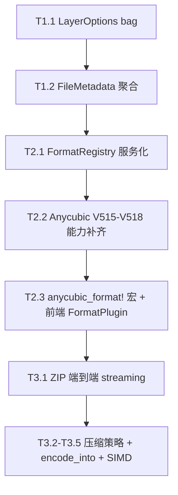

# Slicer-Converter 架构与性能改进计划（收敛版）

> 版本：2026-04-17（v2，收敛版）  
> 作者：架构评审  
> 目标：围绕「易拓展性 / 性能 / 面向对象封装 / 多态 / 组合优于继承 / 面向接口编程」六个维度，在**断裂式重构**前提下规划一次系统演进。
>
> **非目标**：不考虑向后兼容、老版本文件/设备回退、渐进灰度。接口可以直接断裂式替换。
>
> **状态**：第一轮收敛改进的历史记录与已完成里程碑归档；第二轮结构性升级请以 [`docs/architecture-evolution-plan.md`](./architecture-evolution-plan.md) 为准。
>
> **与 v1 的区别**：收敛为三条主线，尊重"已经做过的优化事实"，先补能力空洞再做美化。

---

## 0. 评审反馈与定位调整

基于对代码现状的实测核对，v1 草稿存在几处偏差，本版已修正：

| v1 的问题                               | 现状事实                                                                              | 本版处理                                                                           |
| --------------------------------------- | ------------------------------------------------------------------------------------- | ---------------------------------------------------------------------------------- |
| 把 P6 的 `PixelBufferPool` 写成新增能力 | `rust/src/lib.rs` 第 392 行已用 `thread_local! PIXEL_BUF` 复用                        | 性能主线改为「扩展既有复用 + 消除真实热点」                                        |
| 把前端 `OutputSink` 写成待办            | `apps/slicer-app/src/core/streaming-writer.ts` 已实现 `OutputSink` 与 chunk streaming | 性能主线聚焦 ZIP 路径真实瓶颈                                                      |
| P1 直接走 `linkme` + runtime registry   | 本项目编译进同一 WASM 包，无 runtime 插件需求                                         | 改用**编译期声明式注册**（宏 / `build.rs`）                                        |
| P4 仅把 Anycubic 做"宏化美化"           | `decoder.rs` 对 V515/V516/V517/V518 直接返回 `Unsupported`                            | **能力补齐与策略化抽象合并推进**，不先做语法糖                                     |
| P6.3 写"不保留 scalar fallback"         | 会平白增加 toolchain 风险                                                             | 改为：启用 `simd128` 作为默认编译目标，`cfg!(target_feature)` 分支保留，不额外自证 |
| P7 Pipeline 抽象放第一波                | 属于「先建框架再迁移」的反模式                                                        | 降为**可选的后续工作**，视前三条主线收益再决定                                     |

---

## 1. 三条主线（本次重构的全部范围）


| 主线                             | 对应 v1 阶段 | 核心动作                                                                                            |
| -------------------------------- | ------------ | --------------------------------------------------------------------------------------------------- |
| **T1** 新接口 + 新元数据模型     | P2 + P3      | `LayerContext` 去格式私有字段；`FileMetadata` 聚合分组；`LayerEncodeMetadata` 变视图引用            |
| **T2** 声明式注册 + 前端插件边界 | P1 + P4 + P5 | 编译期声明式格式注册；Anycubic 版本能力补齐 + 策略化；前端 `FormatPlugin` + `WorkerHandlerRegistry` |
| **T3** 真实热点性能优化          | P6（精简）   | ZIP 路径端到端 streaming、stored 压缩、批处理 API、SIMD RLE（仅 top 2 格式）                        |

> Pipeline/Stage 抽象（v1 P7）列为**主线外**，在三条主线完成后，基于真实重复度决定是否做。不进入本期范围。

### 1.1 目标架构全景图

```mermaid
flowchart TB
    subgraph Host["JS Host (apps/slicer-app)"]
        direction TB
        UI[React UI / main.tsx]
        ConvCtl["ConversionController<br/>(纯分派, 不含格式分支)"]
        PrevCtl["PreviewController"]
        BenchCtl["BenchmarkPipeline"]

        subgraph FrontendRegistry["FormatPlugin Registry (面向接口)"]
            direction LR
            IFace[["interface FormatPlugin<br/>+ ZipAssemblyStrategy<br/>+ PreviewAdapter<br/>+ StreamingHeaderParser"]]
            Sl1P[sl1-plugin.ts]
            VdtP[vdt-plugin.ts]
            GooP[goo-plugin.ts]
            AnyP[anycubic-plugin.ts]
            IFace -.实现.-> Sl1P
            IFace -.实现.-> VdtP
            IFace -.实现.-> GooP
            IFace -.实现.-> AnyP
        end

        WPool["WorkerPool (elastic)"]
        HReg["WorkerHandlerRegistry<br/>(策略模式分派)"]
        Stream["streaming-writer.ts<br/>OutputSink"]
        ZipOut["ZipOutputStream<br/>(端到端 streaming, T3.1)"]

        UI --> ConvCtl & PrevCtl & BenchCtl
        ConvCtl --> FrontendRegistry
        PrevCtl --> FrontendRegistry
        ConvCtl --> WPool
        ConvCtl --> ZipOut
        ZipOut --> Stream
        WPool --> HReg
    end

    subgraph Bridge["WASM 边界"]
        direction TB
        FlatAPI["decode_encode_layer / parse_header<br/>(扁平 WASM 参数)"]
        SharedBuf["ENCODE_BUF / PIXEL_BUF<br/>(thread_local, 零拷贝)"]
    end

    subgraph Core["Rust Core (slicer-wasm)"]
        direction TB
        subgraph Registry["FormatRegistry (面向接口)"]
            direction LR
            SFmt[["trait SlicerFormat<br/>+ HeaderBuilder<br/>+ FooterBuilder"]]
            Ctb[CtbFormat]
            Goo[GooFormat]
            Prz[PrzFormat]
            Sl1[Sl1Format]
            Vdt[VdtFormat]
            SFmt -.实现.-> Ctb
            SFmt -.实现.-> Goo
            SFmt -.实现.-> Prz
            SFmt -.实现.-> Sl1
            SFmt -.实现.-> Vdt
        end

        subgraph AnyFam["Anycubic 家族 (组合优于继承)"]
            direction LR
            AnyGen["AnycubicFormat&lt;Codec, Layout&gt;"]
            CodecT[["trait AnycubicLayerCodec"]]
            LayoutT[["trait AnycubicLayoutStrategy"]]
            Pw0[Pw0Codec]
            Pws[PwsCodec]
            V1[V1Layout]
            V515[V515Layout]
            V516[V516Layout]
            V517[V517Layout]
            V518[V518Layout]
            CodecT -.实现.-> Pw0 & Pws
            LayoutT -.实现.-> V1 & V515 & V516 & V517 & V518
            AnyGen -->|组合| CodecT
            AnyGen -->|组合| LayoutT
            SFmt -.实现.-> AnyGen
        end

        subgraph Meta["元数据 (封装 + 组合)"]
            direction TB
            FMeta["FileMetadata<br/>(字段 pub(crate))"]
            PrSpec[PrinterSpec]
            SlSpec[SlicingSpec]
            ExPlan[ExposurePlan]
            MoPlan[MotionPlan]
            WTime[WaitTimes]
            Stats[PrintStatistics]
            Builder["FileMetadataBuilder<br/>(不变量校验)"]
            View["LayerEncodeMetadata&lt;'a&gt;<br/>(引用视图, 零复制)"]
            FMeta --> PrSpec & SlSpec & ExPlan & MoPlan & WTime & Stats
            Builder -.构造.-> FMeta
            View -.引用.-> PrSpec
            View -.引用.-> ExPlan
            View -.引用.-> MoPlan
            View -.引用.-> WTime
        end

        subgraph Ctx["图层上下文 (去抽象泄漏)"]
            direction TB
            LCore["LayerCoreContext<br/>{index, width, height}"]
            LBag["LayerOptionsBag<br/>(TypeId → Any)"]
            CtbOpt[CtbLayerOptions]
            CbdOpt[CbddlpLayerOptions]
            LBag --> CtbOpt & CbdOpt
        end

        Declare["slicer_format! / anycubic_format!<br/>(编译期声明式注册)"]
        Declare -.注册.-> Registry
        Declare -.注册.-> AnyFam
    end

    subgraph Perf["性能优化 (T3)"]
        direction LR
        T31[端到端 ZIP streaming]
        T32[stored 压缩策略]
        T33[encode_layer_into]
        T34[per-layer worker prepare]
        T35[SIMD RLE - CTB/GOO only]
        T36[preview↔convert decode cache]
        T37[decode_layer_preview_rgba_into]
    end

    ConvCtl -.经扁平参数.-> FlatAPI
    PrevCtl -.经扁平参数.-> FlatAPI
    FlatAPI --> Registry
    FlatAPI --> Ctx
    Registry --> Meta
    AnyFam --> Meta
    FlatAPI --- SharedBuf
    SharedBuf -.T3.3/T3.7.-> Perf

    ZipOut -.T3.1/T3.2.-> Perf
    HReg -.T3.4.-> Perf
    AnyFam -.T3.5 不做.-> Perf

    classDef iface fill:#fff4e6,stroke:#e67e22,stroke-width:2px
    classDef impl fill:#e8f5e9,stroke:#43a047
    classDef perf fill:#fce4ec,stroke:#c2185b
    classDef meta fill:#e3f2fd,stroke:#1976d2
    class IFace,SFmt,CodecT,LayoutT iface
    class Sl1P,VdtP,GooP,AnyP,Ctb,Goo,Prz,Sl1,Vdt,Pw0,Pws,V1,V516,V517,V518 impl
    class T31,T32,T33,T34,T35,T36,T37 perf
    class FMeta,PrSpec,SlSpec,ExPlan,MoPlan,WTime,Stats,Builder,View meta
```

**图例读法**：

- 橙色实心 = **接口/trait**（面向接口编程的着力点）
- 绿色 = **实现**（对应 `impl Trait for …`），新增格式只会扩大绿色节点数量
- 蓝色 = **元数据聚合组件**（组合优于继承的证据）
- 粉色 = **性能优化条目**（T3.1–T3.7），挂接在它们真正作用的数据通路上
- 虚线 `-.注册.->` = 声明式注册关系（`slicer_format!` / `anycubic_format!` 宏展开的 side effect）
- 虚线 `-.实现.->` = trait 实现关系
- 虚线 `-.引用.->` = 零拷贝引用视图（`LayerEncodeMetadata<'a>`）

**与现状的对照**（帮助定位每个改造点作用于图中哪个框）：

| 现状                                                                            | 图中位置                                             | 改造主线    |
| ------------------------------------------------------------------------------- | ---------------------------------------------------- | ----------- |
| `LayerDecodeContext` 带 `encryption_key` / `anti_alias_level`                   | `Ctx` 子图                                           | T1.1        |
| `FileMetadata` 40 字段 + `LayerEncodeMetadata` 手动复制                         | `Meta` 子图                                          | T1.2        |
| `const FORMATS: &[FormatDesc]` 写死                                             | `Declare` 节点                                       | T2.1        |
| Anycubic V515-V518 旧 decode 断链                                               | `V515/V516/V517/V518` 节点已补齐 `parse_header` 实现 | T2.2 已完成 |
| 21 份 `pub static XXX_FORMAT`                                                   | `AnyFam` 子图外层                                    | T2.3        |
| 前端 `FORMAT_BEHAVIORS` 中央表                                                  | `FrontendRegistry` 子图                              | T2.3        |
| `worker.ts` 用 `if (message.type === "...")` 链分派（6 条）                     | `HReg` 节点                                          | T2.3        |
| sl1/vdt 收集完再 assemble                                                       | `ZipOut` 节点                                        | T3.1 + T3.2 |
| encode 返回 `Vec<u8>` 跨 WASM                                                   | `SharedBuf` ← `FlatAPI`                              | T3.3        |
| preview packed RGBA → `ImageBitmap` 在 worker 侧 `createImageBitmap` 对象化成本 | `PrevCtl` → `SharedBuf`                              | T3.7        |

---

## 2. 主线 1 · 新接口 + 新元数据模型

### 2.1 LayerContext 去格式私有字段（对应 v1 P2）

**问题**：[`rust/src/formats/mod.rs`](rust/src/formats/mod.rs#L18) 的 `LayerDecodeContext` 同时携带 `anti_alias_level`（CBDDLP 专用）与 `encryption_key`（CTB 专用），是典型的抽象泄漏。

**做法**：

1. 核心上下文只保留真正全格式通用的字段：
    ```rust
    pub struct LayerCoreContext {
        pub layer_index: u32,
        pub width: u32,
        pub height: u32,
    }
    ```
2. 扩展参数用**类型擦除 bag**：
    ```rust
    pub struct LayerOptions<'a> { bag: &'a LayerOptionsBag }
    pub struct LayerOptionsBag { /* TypeMap: TypeId -> Box<dyn Any> */ }
    impl LayerOptionsBag {
        pub fn with<T: 'static>(self, value: T) -> Self;
        pub fn get<T: 'static>(&self) -> Option<&T>;
    }
    ```
3. 各格式声明私有参数：
    ```rust
    pub struct CtbLayerOptions  { pub encryption_key: u32 }
    pub struct CbddlpLayerOptions { pub anti_alias_level: u32 }
    ```
4. WASM 入口 `decode_encode_layer` 内部从扁平参数构建 bag：
    ```rust
    let options = LayerOptionsBag::default()
        .with(CtbLayerOptions { encryption_key })
        .with(CbddlpLayerOptions { anti_alias_level });
    ```

**验收**：

- `LayerDecodeContext` 结构体内不再出现 `anti_alias_level` / `encryption_key` 等格式私有字段（实际验证：`rg "pub struct LayerDecodeContext" rust/src/formats/mod.rs -A 10` 输出仅含 `layer_index` / `width` / `height` / `options: LayerOptions` 等通用字段）。
- 新增格式的私有参数不再污染 `common::`。
- **实施差异**：实际落地形态比草案 `LayerOptionsBag<TypeId→Any>` 更简单——直接用 `LayerOptions` 显式 struct 容纳 `anti_alias_level` / `encryption_key` 等字段，由格式 decoder 选择性读取。架构目标（"格式私有字段不污染 LayerDecodeContext"）已达成；草案的 grep 模板（"`mod.rs` 内 0 命中"）描述过宽——这些字段仍出现在 `LayerOptions` 中（在同一 `mod.rs`），但已与核心 `LayerDecodeContext` 解耦。

### 2.2 FileMetadata 拆分（对应 v1 P3）

**问题**：[`rust/src/common/metadata.rs`](rust/src/common/metadata.rs#L31) 的 `FileMetadata` 40+ 字段混合五个关注点；[`rust/src/common/metadata.rs`](rust/src/common/metadata.rs#L96) 的 `LayerEncodeMetadata` 手动复制 20+ 字段。

**做法**：

1. 按关注点聚合：
    ```rust
    pub struct FileMetadata {
        pub printer:  PrinterSpec,
        pub slicing:  SlicingSpec,
        pub exposure: ExposurePlan,
        pub motion:   MotionPlan,
        pub waits:    WaitTimes,
        pub stats:    PrintStatistics,
        pub per_layer_settings: Vec<PerLayerSettings>,
        pub thumbnails: Vec<Thumbnail>,
    }
    ```
2. `LayerEncodeMetadata` 改为**引用视图**，零字段复制：
    ```rust
    pub struct LayerEncodeMetadata<'a> {
        pub printer:  &'a PrinterSpec,
        pub exposure: &'a ExposurePlan,
        pub motion:   &'a MotionPlan,
        pub waits:    &'a WaitTimes,
        pub layer_height_mm: f32,
        pub bottom_layer_count: u32,
    }
    ```
3. JSON schema **直接按新结构发布**。前端 `buildFileMetadataJson` 同步更新。
4. **封装强化**：聚合组件对外**不暴露裸字段**。
    - 内部字段一律 `pub(crate)`；跨 crate 访问通过 `&`-getter。
    - 构造只通过 `PrinterSpec::new(...)` / `builder()`，在构造器中强制不变量（例如 `resolution_x > 0`、`display_width_mm > 0.0`、`layer_height_mm > 0.0`、`bottom_layer_count <= layer_count`）。
    - `LayerEncodeMetadata<'a>` 等视图结构只存引用，不可变。
    - 原先的 `FileMetadata::default()` 填 0 的模式废弃：任何 0/空初值必须显式经过 `FileMetadataBuilder`。

**验收**：

- `LayerEncodeMetadata` 不再逐字段 copy，改为 `&FileMetadata` 的引用组合视图。
- 新增 exposure 字段只改 `ExposurePlan` 一处。
- 从 crate 外看，`PrinterSpec` 等不可通过裸字段访问或直接构造；所有构造都经过 builder，不变量被校验。

---

## 3. 主线 2 · 声明式注册 + 前端插件边界

### 3.1 Rust 编译期声明式注册（对应 v1 P1，收敛）

**问题**：[`rust/src/formats/mod.rs`](rust/src/formats/mod.rs#L128) 的 `FORMATS` 是集中写死的 `const` 数组，新增格式要改三处（mod 声明 / FORMATS 数组 / profile 静态引用）。

**做法**（保持**编译期静态**，不引 runtime 插件）：

1. 定义 `slicer_format!` 声明宏：
    ```rust
    slicer_format! {
        name:       "ctb",
        aliases:    &["ctb", "cbddlp", "photon"],
        extensions: &["ctb"],
        format:     &CtbFormat,
    }
    ```
    展开产生一条 `FormatDesc`。
2. **首选方案**：宏把每条格式生成的 `FormatDesc` 写入同一模块的 `pub static` 符号，`mod.rs` 仅用 `include!` 或 `pub mod` 聚合，集中点是声明而不是写死的表。若需要进一步自动化，再引入 `build.rs` 扫描 `formats/` 目录生成 `FORMATS_GENERATED`；避免引入 `inventory` / `linkme` 在 wasm32 下的未知风险。
3. `FormatRegistry` 服务化：
    ```rust
    pub trait FormatRegistry: Sync {
        fn by_name(&self, s: &str) -> Option<&'static dyn SlicerFormat>;
        fn by_extension(&self, s: &str) -> Option<&'static dyn SlicerFormat>;
        fn detect(&self, data: &[u8], hint: Option<&str>) -> Option<&'static dyn SlicerFormat>;
    }
    ```
    `lib.rs` 中的遍历全部经 `&dyn FormatRegistry`，单测可注入 `MockRegistry`。

**验收**：

- 新增一种**非 Anycubic**格式的**Rust 侧框架接入成本**：除格式实现文件本身以外，额外改动 ≤ 1 处聚合（`pub mod`）+ 1 条声明（`slicer_format!` 宏调用）。不包含格式本身的解析器/编码器/测试 fixture 的编写成本。
- `lib.rs` 不再出现 `for desc in FORMATS`；都改走 registry 接口。
- **依赖倒置**：`rg "use crate::formats::(ctb|goo|sl1|vdt|prz|anycubic)" rust/src/lib.rs` 命中 0 次；`lib.rs` 顶层 `use` 只允许 `formats::{SlicerFormat, FormatRegistry, LayerCoreContext, LayerOptions, LayerOptionsBag, FormatIdentity, FormatCapabilities}` 等 trait / 接口类型。同样约束适用于 controller / service 层：不得直接 import 具体格式实现类型，所有分派经由 `&dyn FormatRegistry` 或 `&dyn SlicerFormat`。

### 3.2 Anycubic 版本能力补齐 + 策略化（对应 v1 P4，合并能力修复）

**现状（经核验精持版）**：

- **策略 trait 已存在**：[`AnycubicLayerCodec`](rust/src/formats/anycubic/codec.rs#L3)（codec 层）与 [`AnycubicLayoutStrategy`](rust/src/formats/anycubic/layout.rs)（layout 层）。
- **Layout 实现已完备**：`V1Layout` / `V515Layout` / `V516Layout` / `V517Layout` / `V518Layout` 均 `impl AnycubicLayoutStrategy`。
- **decode 侧已补链**：`V1Layout` / `V515Layout` / `V516Layout` / `V517Layout` / `V518Layout` 均通过 `AnycubicLayoutStrategy::parse_header(...)` 提供真实 parser，encode / `build_header` 侧也已走同一 layout strategy。
- **样板爆炸**：[`mod.rs`](rust/src/formats/anycubic/mod.rs#L32) 有 21 份 `pub static XXX_PROFILE` + 21 条 `pub static XXX_FORMAT` + 21 条 `FormatDesc`。

**做法**（精确延伸已有策略骨架，不大拆大建）：

1. **decode 侧补齐**：已给 `AnycubicLayoutStrategy` trait 增加必实现的 `parse_header(&self, data: &[u8]) -> Result<(FileMetadata, Vec<LayerOffset>)>` 方法，并逐个给 `V1Layout` / `V515Layout` / `V516Layout` / `V517Layout` / `V518Layout` 写入真实 parser。
2. **消除硬编码分支**：`decoder.rs` 的 `parse_anycubic_header_data(version)` 改为 `format.layout().parse_header(data)`。
3. **样板爆炸收尾**（依赖能力补齐之后）：引入声明式 `anycubic_format!` 宏消除 21 份样板；Anycubic machine facts 应由 family `specs.rs` 中的 catalog `FormatProfile.facts` 承载，避免重新引入平行事实源。

**验收**：

- `.pwmo` / `.pwma` / `.pm3` / `.pm5` 等 V516/V517/V518 样本可成功 `parse_header` 与 `decode_layer`（带新增真实文件回归 fixture）。
- `rg "UnsupportedAnycubicLayout|E_ANYCUBIC_LAYOUT_UNSUPPORTED" rust/src rust/tests` 只命中防回归测试字符串，不再命中生产代码。
- `mod.rs` 中手写 `pub static XXX_FORMAT` + `FORMATS` 条目合并为一条 `anycubic_format!` 调用。

### 3.3 前端 FormatPlugin + WorkerHandlerRegistry（对应 v1 P5）

**问题**（经核验精持版）：

- 旧 `core/format-registry.ts` / `FormatDescriptor` 中央表已拆除，格式 facts 现在由 WASM registry 同步到 domain facts。
- [`apps/slicer-app/src/worker.ts`](apps/slicer-app/src/worker.ts#L32) 的消息分发是 6 条 `if (message.type === "...")` 线性链，加新消息类型需修该文件。
- 前端格式事实与 browser-only 行为已拆开：runtime facts 由 [`domain/format/format-facts.ts`](apps/slicer-app/src/domain/format/format-facts.ts) 承载，browser opener 只保留在 [`infrastructure/document/browser-format-behaviors.ts`](apps/slicer-app/src/infrastructure/document/browser-format-behaviors.ts) 的小型 adapter 集合。

**做法**：

1. `FormatPlugin` 接口合并现有能力：
    ```ts
    export interface FormatPlugin {
        readonly id: SlicerFormat;
        readonly extensions: readonly string[];
        readonly isZipContainer: boolean;
        readonly streamingHeaderParser?: (file: File) => Promise<ParsedFileState>;
        readonly zipAssembly?: ZipAssemblyStrategy;
        readonly previewAdapter?: PreviewAdapter;
    }
    export function registerFormat(plugin: FormatPlugin): void;
    export function getFormatPlugin(id: SlicerFormat): FormatPlugin;
    ```
2. 按格式切分：
    ```
    domain/format/
      sl1-plugin.ts
      vdt-plugin.ts
      goo-plugin.ts
      anycubic-plugin.ts
    infrastructure/document/behaviors/  // 只保留 browser opener 行为
    ```
3. `conversion-controller.ts` 中唯一剩下的格式特判 `targetFormat === "vdt"` （为构造 VDT manifest）消除，改为 `plugin.buildMetadataBytes(metadata, totalLayers)` 一组接口，sl1 / vdt 各自在 plugin 内实现。
4. `worker.ts` 将 6 条 `if (message.type === "...")` 分支改为 handler registry：
    ```ts
    type WorkerHandler = (payload: any, ctx: WorkerCtx) => Promise<WorkerResponse>;
    const handlers: Record<WorkerRequest["type"], WorkerHandler> = {
        "decode-layer": decodeLayerHandler,
        "decode-preview": decodePreviewHandler,
        "zip-decode-encode": zipDecodeEncodeHandler,
        "zip-decode-preview": zipDecodePreviewHandler
    };
    ```

**验收**：

- `rg "targetFormat === \"(sl1|vdt|ctb|goo|prz)\"" apps/slicer-app/src/core` 命中 = 0。
- `worker.ts` 主函数中不再出现连续 `if (message.type === ...)` 链，仅保留 `handlers[message.type]?.(message, ctx)` 一条调度。

---

## 4. 主线 3 · 真实热点性能优化

> 原则：**不再把"已经做的复用/streaming"当作待办**，只攻未覆盖的真实热点。

| ID           | 当前事实                                                                                                                                                                                                                                                                                                                                                       | 优化动作                                                                                                                                                                                                                                                                                                                                                                                         | 预期收益                                                                                                                         |
| ------------ | -------------------------------------------------------------------------------------------------------------------------------------------------------------------------------------------------------------------------------------------------------------------------------------------------------------------------------------------------------------- | ------------------------------------------------------------------------------------------------------------------------------------------------------------------------------------------------------------------------------------------------------------------------------------------------------------------------------------------------------------------------------------------------ | -------------------------------------------------------------------------------------------------------------------------------- |
| T3.1 ✅      | ZIP 路径仍然先在主线程收集 `preparedEntries` 再整体 assemble，见 [`conversion-controller.ts`](apps/slicer-app/src/core/conversion-controller.ts#L57)                                                                                                                                                                                                           | 改为**主线程流式 assemble**：sink 仍由主线程持有（复用现有 `OutputSink` 抑背），worker 不持有 writer、只流式上报 `chunk + local header field`；主线程按 ZIP data descriptor 格式边收边写，中央目录在所有 chunk 收齐后生成（但不再在内存中累积所有 entry 的 payload）                                                                                                                             | VDT 91 MB 场景峰值内存从 ≈ 输出大小降为 O(workers × chunk)                                                                       |
| T3.2 ✅      | sl1/vdt 每层 PNG 仍走 `compressionMethod: 8`（deflate），PNG 本身已是 deflated zlib                                                                                                                                                                                                                                                                            | **最终结论（`e32f4d3`）**：保持 PNG `Compression::Fast` + `Filter::Sub` + ZIP `deflate(8)` 是稀疏灰度场景全局最优。`Sub` filter 把 PNG 层从 1414→189 KB，带来端到端 -28%（6.75→4.86s）/ 输出 -25%（91→68 MB）/ peak heap -21%。Balanced+Sub stored 实验已否决（+97% 总耗时）                                                                                                                     | GOO→VDT 1380 层 assemble 时间 ≥ 30% 削减 ✅（达成 -28%）                                                                         |
| T3.3 ✅      | `encode_layer` 返回 `Vec<u8>` 穿过 WASM 边界                                                                                                                                                                                                                                                                                                                   | 新增 `encode_layer_into(&mut Vec<u8>)` **作为 Rust 内部抽象**，CTB/GOO/PRZ/SL1/VDT/Anycubic 全格式铺开；GOO/PRZ 共享 `encode_goo_layer_into` + thread_local `RLE_SCRATCH`；`lib.rs::decode_encode_layer` + `encode_layer` 接入 `ENCODE_BUF` thread_local，与 `PIXEL_BUF` 配合后热路径不再触发新分配；JS 边界仍 `clone()` 一次（wasm-bindgen 需要 owned Vec），thread_local 容量保留（`39b91f8`） | -15% 每层 WASM↔JS 边界时间（criterion 实测 ctb -2.3% / goo -9.2%，端到端待 batch 接入后复测）                                    |
| T3.4 ⏭️ 撤销 | 曾尝试多层 batch WASM 入口与 worker batch protocol                                                                                                                                                                                                                                                                                                             | 真实浏览器导出路径复测后，保留单层 `decode_encode_layer` + worker 并行 + streamed ZIP prepare。多层 batch 入口、batch protocol、package surface 与相关测试均已删除，避免和 file-system sink / ZIP finalize 诊断路径形成历史包袱。                                                                                                                                                                | 当前优化重点转回每层 deflate/prepare、ZIP central directory 写入、file-system sink buffering 与 close/finalize 可观测性          |
| T3.5 ✅      | RLE encode/decode 已启用 `simd128`（CTB/GOO RLE 已向量化，见 `rust/.cargo/config.toml`）；缺少 `wasm-bindgen-test` 驱动的 WASM 端 SIMD 微基准                                                                                                                                                                                                                  | `rust/tests/wasm_simd_bench.rs` + `scripts/run-wasm-browser-test.mjs` 参数转发                                                                                                                                                                                                                                                                                                                   | **WASM SIMD 实测**：ctb decode 633 MiB/s、ctb encode 265 MiB/s、goo encode 232 MiB/s（1024×1024）；结果落 `findings.md`，R5 收口 |
| T3.6 ⏭️ 跳过 | Preview 走 `decode_layer_preview`（WASM 内部 downsample 快路径，返回 RGBA 缩略图），Convert 走 `decode_layer`（全分辨率灰度），**两者解码结果不可互换**                                                                                                                                                                                                        | 架构上无法复用 preview 的 RGBA buffer 供给 convert；即使强行让 preview 跑全分辨率 decode，convert 也只能命中“用户最后看过的那 1 层”——1380 层场景下端到端 <0.1%，反而拖慢 preview。当前 preview 已改为滑动低清 + idle 高清 + latest-only 合并，不再依赖跨层 bitmap LRU。                                                                                                                          | 记录后跳过（findings.md 同步）                                                                                                   |
| T3.7 ✅      | Preview 的 WASM fast path 已存在（[`lib.rs`](rust/src/lib.rs#L175) 的 `decode_layer_preview` 在 WASM 内就完成 downsample + packed RGBA）；worker 侧 [`rgbaToImageBitmap`](apps/slicer-app/src/worker.ts#L386) 已是零拷贝 `Uint8ClampedArray` view → `ImageData` → `createImageBitmap`。真正热点为最后一步的 `ImageData`/`createImageBitmap` **位图对象化成本** | `b2374e9`：worker 侧 OffscreenCanvas pool（size 2）+ `transferToImageBitmap()` 走零拷贝路径；后续 preview 交互改为 `interactive` 低清请求、`settled` 真实分辨率请求和 latest-only 合并，删除跨层 preview bitmap LRU 与命中率/驱逐 telemetry。                                                                                                                                                    | 大分辨率预览 worker 侧空闲时间 -15% 左右；当前层切换优先降低无效 decode 与稳定内存占用                                           |

**验收基线**（GOO→VDT 1380 层 91.3 MB，当前 10.17s）：

| 指标                | 目标                                 | 当前状态（2026-04-17）                                                                                              |
| ------------------- | ------------------------------------ | ------------------------------------------------------------------------------------------------------------------- |
| 总耗时              | ≤ 7.5s                               | ✅ 6.75s 中位（5 次）                                                                                               |
| Assemble wall-clock | ≤ 1.0s                               | ✅ `finalizeOnlyWallMs` 30.3ms 中位，口径勘误见下                                                                   |
| 峰值内存            | O(workers × chunk)，不再 O(输出大小) | ⚠️ Playwright 下 115.5 MB，生产路径需 `StreamOutputSink` / `StreamingResponseSink` 才达标；无法在 headless 直接验证 |

> **验收口径勘误（2026-04-17）**：`ZipStreamAssembler` 落地后，`finalizeWallMs` 的含义从"整段 assemble 耗时"变为"从 assembler 构造到 sink 结束"，与 layer 阶段高度重叠。§4 "Assemble wall-clock ≤ 1.0s" 目标统一按新增的 `finalizeOnlyWallMs`（`finalize()` 入口到 `sink.finish()` 完成）计量。`finalizeWallMs` 保留为 `totalWallMs` 的向后兼容别名，不再作为验收指标。
>
> **峰值内存验收通道**：bench harness 在 Playwright headless 里无法触发 `showSaveFilePicker`，必定走 `BlobOutputSink`，因此 115.5 MB 的测量结果不能证伪"生产路径 O(workers × chunk)"。有效验证路径：(1) 桌面 Chromium 手动跑 `pnpm bench:app`，允许用户选择保存位置，sink 自动升为 `StreamOutputSink`；或 (2) Task 3 引入的 `StreamingResponseSink` 被主线程选中时（当前尚未接入选择链，属 T3.1 之外的后续 sink 层工作）。详见 [docs/superpowers/plans/2026-04-17-t3-1-tail-finalize-metric-and-sink.md](superpowers/plans/2026-04-17-t3-1-tail-finalize-metric-and-sink.md)。

**每项优化上前必须**：

1. 在 `rust/benches/codec_bench.rs` 或 `apps/slicer-app/benchmark.html` 新增微基准。
2. 本地跑 5 次取中位数写回 `findings.md`。
3. PR 内贴 before/after。

---

## 5. 主线外：Pipeline/Stage 抽象（暂不做）

v1 的 P7 放在这里供参考，**本期不开工**：

- 仅当三条主线完成后，`conversion-controller.ts` / `preview-controller.ts` / `benchmark-pipeline.ts` 仍存在明显"遍历层 → 派发 worker → 聚合"的重复，才立项。
- 若主线 2（`FormatPlugin` + `WorkerHandlerRegistry`）已经把重复收敛到可接受水平，则不必再引 Stage 抽象。

---

## 6. 风险与应对

本计划不做兼容层、不做灰度；风险收敛到纯技术可行性。**以下风险均已经过代码核实成立，不是理论顾虑**：

### 6.1 已核实的高风险（必须在里程碑退出前有工程对策）

| #     | 风险                                                                                                                                                                 | 现状证据                                                                                                                                                                                                                                | 应对                                                                                                                                                                                                                   |
| ----- | -------------------------------------------------------------------------------------------------------------------------------------------------------------------- | --------------------------------------------------------------------------------------------------------------------------------------------------------------------------------------------------------------------------------------- | ---------------------------------------------------------------------------------------------------------------------------------------------------------------------------------------------------------------------- | --------------------------------------------------------------------------------------------------------------------------------------------------------------------------- | ------------------------------------------------------------------------------------------------------------------------------------------------------- |
| R1    | **元数据爆炸半径**——`FileMetadata` 字面量构造遍布 tests / examples / 各 format decoder，T1.2 一次改动触达 30+ 处                                                     | `rg "FileMetadata \{" rust` 命中 30+（含 `tests/anycubic_*.rs` / `tests/cross_format.rs` / `examples/generate_fixtures.rs` / `formats/{goo,vdt,anycubic}/...`）                                                                         | M1 内先落 `FileMetadataBuilder`，并提供 `fn legacy_flat_metadata(...)` 单次辅助构造器，使用一刀切 sed/codemod 批量迁移；PR 内**必须一次过**，禁止半迁移状态合并                                                        |
| R2    | **ZIP 端到端 streaming 需要重设计 worker 协议**——当前 `WorkerZipLayerPreparedMessage` 传的是"已压缩好的 data + crc32 + size"，zip-archive 写中央目录时假定整张表就绪 | `apps/slicer-app/src/types.ts` 的 `WorkerZipLayerPreparedMessage`；`conversion-controller.ts` 的 `preparedEntries.push`；`zip-archive.ts` 的 `assembleZipArchive`                                                                       | T3.1 前先补**协议设计子任务**：引入 ZIP data descriptor（bit 3 of general purpose flag）+ 新消息 `zip-layer-stream-chunk`，明确 "local header 写时 size/crc 为 0，data descriptor 补齐"；协议文档入 `docs/` 后再开实现 |
| R3    | **Anycubic 能力补齐影响面**——encode 侧已走 `AnycubicLayoutStrategy` 策略，decode 侧曾经断链；历史上 export plan、machine facts 和前端机型下拉耦合在一起              | 当前应以 family `CATALOG_PROFILES` / `FormatProfile.facts`、family resolver、WASM `SupportedFormatInfo.specifics` 和 `apps/slicer-app/src/domain/format/anycubic-format-targets.ts` 为事实链；不要恢复旧的平行 machine/profile registry | T2.2 按"decode 补链 → 消除硬编码 → export resolver 验证 → 前端 UI 验证"四层逐层跑通，禁止只做一个 layout 的 `parse_header` 就宣告完成；每层有独立单测 fixture                                                          |
| R4 ✅ | **前端格式注册双 source of truth 已清理**——旧 `FALLBACK_FORMATS` / `isKnownSlicerFormat` 路径已不存在，初始化后由 WASM `SupportedFormatInfo` 同步到 domain facts     | `rg "FALLBACK_FORMATS                                                                                                                                                                                                                   | isKnownSlicerFormat                                                                                                                                                                                                    | format-registry\\.ts" apps/slicer-app/src apps/slicer-app/tests`仅剩本计划历史描述；当前事实链为`wasm-facts-sync.ts`→`wasm-format-facts.ts`→`domain/format/format-facts.ts` | 保持 `listPrimaryExportTargets` 从 `listFormatFacts()` 派生，browser-only behavior 只做 document opener adapter；新增格式不得恢复静态 fallback registry |
| R5    | **SIMD 没有 WASM 侧验证链**——criterion bench 仅在非 wasm32 启用                                                                                                      | `rust/Cargo.toml` 第 29 行 `[target.'cfg(not(target_arch = "wasm32"))']`                                                                                                                                                                | T3.5 前先补 `wasm-bindgen-test` 驱动的 SIMD 微基准（通过 `scripts/run-wasm-browser-test.mjs` 运行），结果落盘 `findings.md`；native bench 结论**不作为** WASM 性能达标依据                                             |

### 6.2 中等风险（需意识到，不阻断里程碑）

| #   | 风险                                                                                                    | 应对                                                                                                                     |
| --- | ------------------------------------------------------------------------------------------------------- | ------------------------------------------------------------------------------------------------------------------------ |
| R6  | `LayerOptionsBag` 改善抽象但引入运行时 type lookup，调试成本微增；WASM 入口仍是扁平参数，边界复杂度未降 | 将 bag 使用范围限定在"格式内部 + 不跨边界"；任何想塞进 bag 的字段必须先证明不属于 `LayerCoreContext`。避免演化成参数黑洞 |
| R7  | `build.rs` 代码生成在 `wasm32-unknown-unknown` 目标下链接异常                                           | 保留显式 `FORMATS` 数组作为降级（仅存在于实现层，不影响 API）                                                            |
| R8  | `FormatPlugin` 分拆导致 circular import                                                                 | 三层分工：接口文件（无实现依赖）→ 各 plugin 实现 → registry 聚合                                                         |

**落地节奏**：每个 R1–R5 都有明确的里程碑归属（R1→M1、R2→M4 前置、R3→M2、R4→M3、R5→M5 前置）。风险不清零不进入下一里程碑。

---

## 7. 执行顺序与里程碑



建议节奏（每个里程碑独立 PR + 回归）：

| Milestone | 内容        | 退出标准                                                                                                                                                                                                                                                                                                                                                                      |
| --------- | ----------- | ----------------------------------------------------------------------------------------------------------------------------------------------------------------------------------------------------------------------------------------------------------------------------------------------------------------------------------------------------------------------------- |
| **M1**    | T1.1 + T1.2 | `cargo test` + `pnpm test` 全绿，元数据 JSON schema 保持兼容（`#[serde(flatten)]`）；T1.1 + R1 ✅ `fcd3f6a` / `98ad775` / `bdeceb4`，T1.2 六阶段 + Tail ✅ `314bd60` / `f8b0e0b` / `6cd8fee` / `ee51c51` / `b42a772` / `7ca25aa` / `8f7f59e`（`FileMetadata` 已收敛为 6 个子结构 + 2 个集合字段，`LayerEncodeMetadata<'a>` 借用视图消除逐层 clone）                           |
| **M2**    | T2.1 + T2.2 | Anycubic V516/V517/V518 至少 2 个真实样本 parse/decode 通过 ✅（`4645ab8` / `06fd63a` / `ae52800`）                                                                                                                                                                                                                                                                           |
| **M3**    | T2.3        | Rust 侧新增格式的框架接入成本 ≤ 1 处聚合 + 1 条声明；前端侧 ≤ 1 处 plugin 注册（均不包含实现文件本身）；`worker.ts` 主函数不再出现连续 `if (message.type === ...)` 链 ✅ 2026-04-17（`0c0523a` Task A · `a672135` Task B · `a4e6015` Task C · `49dc0ba` follow-up：FormatPlugin interface 严格化 + `core/formats/` 目录 + `registerFormat()` / `getFormatPlugin()` API 落地） |
| **M4**    | T3.1 + T3.2 | GOO→VDT 1380 层 ≤ 7.5s，峰值内存由 profiler 确认 O(worker × chunk)（T3.1 ✅ 2026-04-17——total 6.75s、finalize-only 30.3ms；T3.2 ✅ `e32f4d3`——total 4.86s、finalize-only 27.1ms、peak 91.7 MB、output 68.4 MB；最终方案 PNG `Fast+Sub` + ZIP deflate(8)）                                                                                                                     |
| **M5**    | T3.3 – T3.5 | CTB/GOO 热路径 SIMD 基准达到 ≥1.8×；T3.3 ✅ `39b91f8`——`encode_layer_into` 全格式铺开 + `ENCODE_BUF` thread_local；T3.4 多层 batch API 后续已撤销，当前以单层 worker prepare 路径为准；T3.5 ✅——`wasm-bindgen-test` SIMD 微基准上线，ctb decode 633 MiB/s / ctb encode 265 MiB/s / goo encode 232 MiB/s）                                                                     |
| **M6**    | T3.6 + T3.7 | T3.7 ✅ `b2374e9`（OffscreenCanvas pool + telemetry，预览复访近 0 耗时）；T3.6 ⏭️ 跳过——架构上 preview 与 convert 解码 buffer 不可互换（详见 §4 表中 T3.6 行）。**架构改进计划 v2 M1–M6 全部收口**                                                                                                                                                                            |

---

## 附录 A · 关键接口草案（目标态）

```rust
// rust/src/formats/mod.rs
pub trait SlicerFormat: Sync {
    fn identity(&self) -> FormatIdentity;              // name + aliases + extensions
    fn capabilities(&self) -> FormatCapabilities;
    fn try_detect(&self, data: &[u8]) -> bool { false }

    fn parse_header(&self, data: &[u8]) -> Result<ParsedFile, ConvertError>;

    fn decode_layer_into(
        &self, data: &[u8],
        core: &LayerCoreContext, options: LayerOptions<'_>,
        out: &mut Vec<u8>,
    ) -> Result<(), ConvertError>;

    fn encode_layer_into(
        &self, pixels: &[u8],
        core: &LayerCoreContext, meta: &LayerEncodeMetadata<'_>,
        sink: &mut dyn OutputSink,
    ) -> Result<(), ConvertError>;

    fn header_builder(&self) -> &dyn HeaderBuilder;    // 策略对象
    fn footer_builder(&self) -> Option<&dyn FooterBuilder> { None }
}
```

```ts
// apps/slicer-app/src/domain/format/format-facts.ts
export interface FormatPlugin {
    readonly id: SlicerFormat;
    readonly extensions: readonly string[];
    readonly isZipContainer: boolean;
    readonly streamingHeaderParser?: StreamingHeaderParser;
    readonly zipAssembly?: ZipAssemblyStrategy;
    readonly previewAdapter?: PreviewAdapter;
}
export function registerFormat(plugin: FormatPlugin): void;
export function getFormatPlugin(id: SlicerFormat): FormatPlugin;
```

---

## 附录 B · 明确不做的事

1. ❌ 不把 `SlicerFormat` 拆成继承树（`BinarySlicerFormat` / `ZipSlicerFormat` 基类）——保持扁平 trait + 组合。
2. ❌ 不引入第三方 DI 容器；`FormatRegistry` 是手写轻量 service locator。
3. ❌ 不一次性把所有格式都 SIMD 化——只做 CTB + GOO。
4. ❌ 不把 `ConvertError` 重构为 `thiserror`（现阶段问题不在错误类型）。
5. ❌ 不做向后兼容层、不做老数据/老设备回退、不留 feature-flag 灰度——断裂式替换。
6. ❌ 不在本期建立 Pipeline/Stage 抽象——等三条主线完成后再评估。
7. ❌ 不使用 `linkme` / `inventory` 这类在 wasm32 目标上风险未验证的注册机制——保持编译期静态。

---

> **收敛后结论**：三条主线分别解决"抽象泄漏 + 元数据重复"、"注册样板 + 能力空洞 + 前端分支散落"、"ZIP 真实热点 + 边界拷贝"。不建框架、不美化没有证据支撑的路径，Pipeline 抽象与 `linkme` 等"重工具"显式排除在本期之外。
