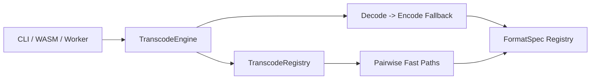

# Fast Path Architecture

> 版本：2026-04-22
> 定位：Rust 内核中“格式对级别”的高性能转码架构说明
> 目标：在不破坏现有 `FormatSpec` 单格式 profile 边界的前提下，为 `goo -> ctb` 以及未来更多 pairwise fast path 提供统一、可扩展、可回退的设计

---

## 0. 文档定位

本文档只回答一个问题：

**当系统后续不只会有 `goo -> ctb` 一条 fast path 时，Rust 内核应该如何组织“格式对级别”的转码能力？**

本文的结论先明确写在前面：

- **方案 C 是本项目 fast path 的最终目标架构**
- `FormatSpec` 继续承担“单格式 profile 能力”边界
- pairwise fast path 统一收敛到独立的 `transcode` 层
- `TranscodeEngine` 是调用层唯一入口
- `LayerTranscoder` 是格式对级别的策略接口
- 没有命中 fast path 或运行时不适用时，统一回退到稳定的 fallback 路径

它不是：

- 单一 `goo -> ctb` 优化方案说明
- `FormatSpec` 重写提案
- 新的全局 runtime / planner 框架

它与现有架构文档的关系如下：

- [`docs/architecture-evolution-plan.md`](./architecture-evolution-plan.md)
    - 定义第二轮系统演进主线
    - 关注整体边界：`OpenedDocument`、`FormatAdapter`、`ConversionSession`
- [`docs/fast-path-architecture.md`](./fast-path-architecture.md)
    - 聚焦 Rust core 内部的**pairwise transcode capability**
    - 解决“fast path 应该挂在哪一层”的问题

换句话说：

- 演进主文档回答“系统边界怎么分”
- 本文回答“格式对级别优化该如何落位”

---

## 1. 问题背景

当前 Rust 内核里已经存在两类能力：

1. **单格式能力**
    - 由 [`rust/src/formats/common/spec.rs`](../rust/src/formats/common/spec.rs) 中的 `FormatSpec` 表达
    - 负责 header parse、单层 decode、单层 encode、header finalize、footer build

2. **跨格式编排**
    - 由 [`rust/src/lib.rs`](../rust/src/lib.rs) 中的 `transcode_layer_with_formats(...)`
    - 以及 [`rust/src/main.rs`](../rust/src/main.rs) 中 CLI 的转码流程承担
    - 本质上是：`decode source -> intermediate pixels -> encode target`

这说明一件事：

**fast path 的语义不属于“单格式能力”，而属于“格式对之间的能力”。**

例如：

- `goo -> ctb`
- `ctb -> goo`
- `pw0 -> goo`
- `goo -> prz`

这些都不是某一个格式“天然拥有”的能力，而是**source × target** 的配对能力。

如果把这类能力直接塞进 `FormatSpec`，会出现抽象层错位：

- `GOO_SPEC` 会被迫理解 `CTB` profile
- `CTB` specs 会被迫理解 `GOO` profile
- 后续每增加一条 pairwise path，单格式 profile 内核都会变得更重

因此，fast path 需要独立于 `FormatSpec` 存在。

---

## 2. 设计目标

本设计以六个维度为判断标准。

| 维度         | 目标                                                                                                                                  |
| ------------ | ------------------------------------------------------------------------------------------------------------------------------------- |
| 易拓展性     | 新增一条 fast path 时，主要修改点应是“新增一个策略实现 + 注册一条 pair”，而不是修改 CLI / WASM / worker 多处主流程                    |
| 性能         | 允许 fast path 绕过完整 `pixel_buf` materialization，并复用 scratch buffer；没有 fast path 时仍保留当前 decode-then-encode 的稳定路径 |
| 面向对象封装 | 调用层只知道 `TranscodeEngine`，不直接知道某条路径的具体实现或启用条件                                                                |
| 多态         | pairwise path 通过 trait/object dispatch 组织，而不是在上层散落 `if source == ... && target == ...`                                   |
| 组合优于继承 | fast path 策略独立存在，不污染 `FormatSpec`；后续共性优先抽内部组件，不引入新的万能父类                                               |
| 面向接口编程 | CLI、WASM、worker 都依赖统一的转码接口，而不是依赖具体的 `goo_to_ctb` 函数文件                                                        |

---

## 3. 反模式与取舍

### 3.1 不推荐方案 A：在调用层硬编码 pair 分支

形式：

- 在 CLI 中写 `if source == "goo" && target == "ctb"`
- 在 WASM 中再写一套
- 在 worker 中再写一套

问题：

- 扩展性差
- 同一能力会在多个入口重复实现
- 难以统一测试和 benchmark
- 后续一旦有 3 条、5 条、10 条 fast path，主流程会迅速膨胀

### 3.2 不推荐方案 B：把 pairwise fast path 塞进 `FormatSpec`

形式：

- 在 `FormatSpec` 里增加 `fast_transcode_to(...)`
- 或 `can_transcode_to(target)` + `transcode_to(...)`

问题：

- 单格式接口被 pairwise 语义污染
- `GOO` 会被迫理解 `CTB`，`CTB` 会被迫理解 `GOO`
- 违反接口隔离原则（ISP）
- 让 `FormatSpec` 从“格式 profile 能力”变成“格式矩阵能力”

### 3.3 方案 C：最终目标架构

形式：

- 新增 `TranscodeEngine`
- 新增 `LayerTranscoder` trait
- 由 registry 管理 `source -> target` 的 fast path 列表
- 没有命中或不适用时，自动回退到通用 fallback

本文将该方案视为最终目标架构。

---

## 4. 目标架构

### 4.1 分层关系



关键原则：

- 调用层只接触 `TranscodeEngine`
- `TranscodeEngine` 先尝试 fast path，再走 fallback
- `FormatSpec` 保持“单格式 profile 能力”定位不变

### 4.2 模块建议

建议新增一层 Rust 模块：

```text
rust/src/transcode/
  mod.rs
  execute.rs
  engine.rs
  registry.rs
  fallback.rs
  request.rs
  paths/
    mod.rs
    goo_to_ctb.rs
```

职责划分：

- `request.rs`
    - 定义 pair、request、scratch、outcome 等类型
- `execute.rs`
    - 封装单层执行 facade：request 组装、scratch buffer 进出、engine 调用
- `engine.rs`
    - 定义 `TranscodeEngine`
    - 统一“尝试 fast path -> fallback”流程
- `registry.rs`
    - 管理 pairwise strategy 的注册和查找
- `fallback.rs`
    - 封装当前稳定的 `decode_layer_into -> encode_layer_into`
- `paths/*`
    - 一条文件一条 fast path

---

## 5. 核心接口草案

### 5.1 Route 与请求上下文

```rust
pub struct TranscodeRouteKey {
    pub source_container: FormatKey,
    pub target_container: FormatKey,
    pub source_layer_codec: FormatKey,
    pub target_layer_codec: FormatKey,
    pub source_pixel_model: FormatKey,
    pub target_pixel_model: FormatKey,
    pub source_crypto: FormatKey,
    pub target_crypto: FormatKey,
}

pub struct TranscodeRouteDescriptor {
    pub route_key: TranscodeRouteKey,
    pub source_family_key: FormatKey,
    pub target_family_key: FormatKey,
    pub source_profile_key: FormatKey,
    pub target_profile_key: FormatKey,
    pub source_header_key: FormatKey,
    pub target_header_key: FormatKey,
    pub source_archive_key: FormatKey,
    pub target_archive_key: FormatKey,
}

pub struct LayerTranscodeRequest<'a> {
    pub layer_index: u32,
    pub width: u32,
    pub height: u32,
    pub display_width_mm: f32,
    pub display_height_mm: f32,
    pub decode_options: &'a crate::formats::LayerOptions,
    pub encode_ctx: crate::formats::LayerEncodeContext<'a>,
}

pub struct LayerTranscodeScratch {
    pub pixel_buf: Vec<u8>,
    pub aux_buf: Vec<u8>,
}
```

设计要点：

- `TranscodeRouteDescriptor` 是转换级 value object，由 `source FormatSpec` 与 `target FormatSpec` 派生
- `route_key` 表达 registry dispatch 所需的策略路由，例如基于 source/target layer codec key 的共享 route
- profile/header/archive/family 等诊断事实保留在 descriptor 上，不进入逐层 request
- `LayerTranscodeRequest` 只表达单层执行参数，不携带 route key、pair 或诊断事实
- `decode_options` 保留现有 `LayerOptions`
- `LayerEncodeContext` 继续沿用现有结构
- `pixel_buf` 仍然保留在 scratch 中，因为 fallback 一定要用到
- `aux_buf` 供 fast path 自由复用，例如临时 run buffer / metadata scratch

### 5.2 Fast path 结果必须允许“声明不适用”

这是本设计的关键点之一。

不是所有 `goo -> ctb` 层都一定能走同一个 fast path。
例如某条未来 fast path 可能只适用于：

- 黑白二值层
- 无 diff chunk
- 无加密
- 某种固定 layout

因此，接口不能假设“只要 pair 匹配就一定可用”，而应支持**运行时放弃并回退**。

```rust
pub enum FastPathOutcome {
    Applied,
    Fallback,
}

pub trait LayerTranscoder: Sync {
    fn try_transcode_layer_into(
        &self,
        src: &[u8],
        req: &LayerTranscodeRequest<'_>,
        scratch: &mut LayerTranscodeScratch,
        out: &mut Vec<u8>,
    ) -> Result<FastPathOutcome, ConvertError>;
}
```

这意味着：

- route 命中只是“有资格尝试”
- 真正是否应用，由策略本身判断
- 上层永远可以保底 fallback

### 5.3 Registry 契约需要明确“查什么、按什么顺序查”

`TranscodeRegistry` 不是可有可无的实现细节，而是方案 C 中非常关键的分发边界。

它至少需要明确三件事：

- 给定一个 `TranscodeRouteKey`，返回哪些可尝试的 `LayerTranscoder`
- 多条策略同时命中时，按什么顺序尝试
- 没有命中时，如何以零歧义方式回到 fallback

当前契约是：

```rust
pub trait TranscodeRegistry: Sync {
    fn lookup_route(&self, route: TranscodeRouteKey) -> &[&'static dyn LayerTranscoder];
}
```

配套约定：

- `lookup_route(route)` 未命中时返回空 slice，而不是 `None`
- registry entry 声明 source/target `FormatSpec`，由 registry 派生 `TranscodeRouteKey`
- 返回顺序必须稳定，通常等同于注册顺序或显式优先级顺序
- `TranscodeEngine` 不负责猜测优先级，只按 registry 给出的顺序依次尝试
- 同一个 route 可以对应多条 strategy，用于表达“更激进路径在前，更保守路径在后”的组合关系

这样做的好处是：

- registry 负责“知道有哪些路可走”
- engine 负责“按既定顺序尝试并在必要时回退”
- strategy 负责“判断自己是否适用并真正执行”

三者职责不会互相污染。

### 5.4 引擎与 fallback

```rust
pub struct TranscodeEngine {
    registry: &'static dyn TranscodeRegistry,
}

impl TranscodeEngine {
    pub fn transcode_layer_into(
        &self,
        src_fmt: &FormatSpec,
        tgt_fmt: &FormatSpec,
        src: &[u8],
        req: &LayerTranscodeRequest<'_>,
        scratch: &mut LayerTranscodeScratch,
        out: &mut Vec<u8>,
    ) -> Result<(), ConvertError> {
        let route = TranscodeRouteDescriptor::from_specs(src_fmt, tgt_fmt);
        for transcoder in self.registry.lookup_route(route.route_key) {
            match transcoder.try_transcode_layer_into(src, req, scratch, out)? {
                FastPathOutcome::Applied => return Ok(()),
                FastPathOutcome::Fallback => {}
            }
        }

        fallback::transcode_layer_with_formats(src_fmt, tgt_fmt, src, req, scratch, out)
    }
}
```

这里故意允许一个 pair 对应多条 strategy：

- 同一个 `goo -> ctb` 可以有“更激进的二值 fast path”
- 也可以有“更通用但稍慢的半优化 path”
- 最后还有统一 fallback

这是“组合优于继承”在这里的具体体现。

---

## 6. 为什么这套设计更适合长期演进

### 6.1 易拓展性

新增一条 fast path 时，目标是：

1. 新增一个 `paths/*.rs`
2. 在 `registry.rs` 注册一条 pair
3. 补对应测试

而不是：

1. 改 CLI
2. 改 WASM
3. 改 worker
4. 改一堆 `if source == ... && target == ...`

### 6.2 性能

这层设计允许两种性能路径并存：

- **fast path**
    - 完全绕过 `pixel_buf`
    - 例如直接把 `GOO black/white run` 映射为 `CTB gray7 run`
- **fallback**
    - 保留现有正确性路径
    - 仍复用 buffer，不需要重新设计一遍

因此它不会为了新抽象牺牲当前稳定性能。

### 6.3 面向对象封装

调用层只表达：

- 我有 source bytes
- 我知道 source/target format
- 我想要目标 layer bytes

至于：

- 有没有 fast path
- 该不该启用
- 失败后怎么回退

都由 engine 内部封装。

### 6.4 多态

多态不再体现在上层分支，而体现在：

- `FormatSpec`：单格式 profile 执行对象，内部组合多种 strategy
- `LayerTranscoder`：格式对多态

两层职责清晰，不互相污染。

### 6.5 组合优于继承

推荐路径不是“引入 FastPathFormat 父类”，而是：

- `FormatSpec` 继续做单格式 profile 边界
- `LayerTranscoder` 作为独立策略对象
- 当多个 fast path 出现共性，再向内部提炼小组件

例如未来可以逐步抽：

- `RunSource`
- `RunSink`
- `EligibilityProbe`

但这些只应在**至少 3 条路径复用同类逻辑**后才出现。

### 6.6 面向接口编程

CLI、WASM、worker 最终都不依赖某个具体的 `goo_to_ctb::transcode(...)`。
它们依赖的是：

- `TranscodeEngine`
- `LayerTranscoder`
- `TranscodeRegistry`

这意味着：

- 单测可以直接 mock/替换 registry
- benchmark 可以单独对 engine 做 A/B
- 调用层不需要知道有哪些 pairwise 路径存在

---

## 7. 与现有代码的衔接建议

### 7.1 第一步：只引入 engine + fallback，不改变行为

落地方式：

- 把 [`rust/src/lib.rs`](../rust/src/lib.rs) 当前的 `transcode_layer_with_formats(...)` 下沉到 `transcode/fallback.rs`
- 新增 `TranscodeEngine`
- 默认 registry 为空

效果：

- 行为保持不变
- 先把“转码层”独立出来

### 7.2 第二步：CLI 与 WASM 改用同一个 engine

改造点：

- [`rust/src/lib.rs`](../rust/src/lib.rs) 的 `decode_encode_layer(s)` 改走 engine
- [`rust/src/main.rs`](../rust/src/main.rs) 的 CLI layer transcode 改走 engine

效果：

- 统一 pairwise transcode 编排
- 避免 CLI / WASM 双份实现继续分叉

### 7.3 第三步：增加第一条 `goo -> ctb` fast path

落地位置：

- [`rust/src/transcode/paths/goo_to_ctb.rs`](../rust/src/transcode/paths/goo_to_ctb.rs)

第一版建议只覆盖：

- `GOO` 黑白 run
- 无 gray chunk
- 无 diff chunk
- 直接输出 `CTB` gray7 run

不满足条件时直接 `Fallback`。

### 7.4 第四步：观察是否值得抽内部共性组件

只有在出现类似：

- `goo -> ctb`
- `prz -> ctb`
- `goo -> pw0`
- `ctb -> goo`

多条路径共用同一类“run reader / writer”逻辑时，
才进一步抽象内部组件。

换句话说：

- 先做 strategy layer
- 再根据真实复用抽组件
- 不提前设计“万能 run IR 框架”

---

## 8. 测试与验证建议

### 8.1 契约测试

每条 fast path 都至少需要以下测试：

1. **正确性等价**
    - fast path 输出必须与 fallback 输出一致
2. **不适用回退**
    - 当 layer 不满足条件时，应返回 `Fallback`
3. **buffer 复用**
    - `scratch` / `out` 可被重复调用复用

### 8.2 引擎测试

建议为 `TranscodeEngine` 本身补测试：

- 命中 fast path 时不走 fallback
- fast path 返回 `Fallback` 时转入 fallback
- 多个 strategy 按注册顺序尝试

### 8.3 Benchmark

仍建议保留两个层面的 benchmark：

1. **真实文件 benchmark**
    - `witch2.goo -> ctb`
    - 观察 total / transcode / worker sum
2. **结构型 profiling**
    - 例如当前新增的 [`rust/examples/profile_rle.rs`](../rust/examples/profile_rle.rs)
    - 判断文件是否真的适合某条 fast path

---

## 9. 最终决策结论

基于当前代码形态和未来扩展预期，最终决策如下：

1. `fast path` 不应放在 CLI
2. `fast path` 不应直接塞进 `FormatSpec`
3. 应新增独立的 `transcode` 层
4. `TranscodeEngine` 作为唯一入口
5. `LayerTranscoder` 作为 pairwise strategy 接口
6. `goo -> ctb` 只是第一条实现，不是一次性特判

简化表述就是：

> `FormatSpec` 负责“单格式 profile 能力”，`TranscodeEngine` 负责“格式对能力”。

这是当前在**易拓展性 / 性能 / 面向对象封装 / 多态 / 组合优于继承 / 面向接口编程**六个维度上最平衡的一种设计。

---

## 10. 不做的事

本文明确不建议：

- 不在 CLI / WASM / worker 各自写一套 pairwise 特判
- 不把 `FormatSpec` 改造成“格式矩阵接口”
- 不提前引入通用 run IR / planner / framework
- 不为了未来可能性，一开始就做过厚抽象

优先顺序应当是：

1. 先把转码层独立出来
2. 再上第一条 `goo -> ctb` fast path
3. 最后根据真实复用决定是否抽更深的内部组件

---

## 11. 当前落地状态（2026-04-22）

本节用于回答一个更实际的问题：

**截至当前代码状态，本文设计已经落到了哪一步？**

结论先写在前面：

- **方案 C 的基础骨架已经完成并进入主流程**
- `CLI` 与 `WASM` 已统一接入 `TranscodeEngine`
- 已有三条真实 pairwise fast path 进入实现态：
    - `goo -> ctb`
    - `prz -> ctb`
    - `ctb -> goo`
- 轻量级的共享 helper 已经出现，但更深一层的通用 run-level 抽象（本文 `§7.4`）**仍未开始**

### 11.1 分阶段对照

| 文档阶段                                    | 当前状态     | 说明                                                                                                |
| ------------------------------------------- | ------------ | --------------------------------------------------------------------------------------------------- |
| `§7.1` 只引入 engine + fallback，不改变行为 | 已完成       | `transcode/` 层已建立，`fallback` 路径独立存在                                                      |
| `§7.2` CLI 与 WASM 改用同一个 engine        | 已完成       | `rust/src/main.rs` 与 `rust/src/lib.rs` 都已走 `TranscodeEngine`                                    |
| `§7.3` 增加第一条 `goo -> ctb` fast path    | 已完成并扩展 | 不仅 `goo -> ctb` 已落地，后续还新增了 `prz -> ctb` 与 `ctb -> goo`                                 |
| `§7.4` 观察是否值得抽内部共性组件           | 轻量启动     | 已出现 `goo_family_to_ctb` 级别的共享 helper，但仍未抽 `RunSource` / `RunSink` / `EligibilityProbe` |

### 11.2 已完成项

#### A. `transcode` 层骨架已落地

本文 `§4.2` / `§5` 提出的目标模块已经基本存在：

```text
rust/src/transcode/
  mod.rs
  execute.rs
  engine.rs
  registry.rs
  fallback.rs
  request.rs
  paths/
    mod.rs
    goo_family_to_ctb.rs
    goo_to_ctb.rs
    prz_to_ctb.rs
    ctb_to_goo.rs
```

对应文件：

- [`rust/src/transcode/mod.rs`](../rust/src/transcode/mod.rs)
- [`rust/src/transcode/execute.rs`](../rust/src/transcode/execute.rs)
- [`rust/src/transcode/engine.rs`](../rust/src/transcode/engine.rs)
- [`rust/src/transcode/registry.rs`](../rust/src/transcode/registry.rs)
- [`rust/src/transcode/fallback.rs`](../rust/src/transcode/fallback.rs)
- [`rust/src/transcode/request.rs`](../rust/src/transcode/request.rs)
- [`rust/src/transcode/paths/mod.rs`](../rust/src/transcode/paths/mod.rs)
- [`rust/src/transcode/paths/goo_family_to_ctb.rs`](../rust/src/transcode/paths/goo_family_to_ctb.rs)
- [`rust/src/transcode/paths/goo_to_ctb.rs`](../rust/src/transcode/paths/goo_to_ctb.rs)
- [`rust/src/transcode/paths/prz_to_ctb.rs`](../rust/src/transcode/paths/prz_to_ctb.rs)
- [`rust/src/transcode/paths/ctb_to_goo.rs`](../rust/src/transcode/paths/ctb_to_goo.rs)

这意味着方案 C 已不是“纯设计目标”，而是已经进入实现态。

#### B. `TranscodeEngine` 已成为统一入口

本文 `§4.4` / `§7.2` 中的关键判断是：

> 调用层只接触 `TranscodeEngine`

这一点当前已经成立：

- WASM 入口通过 [`rust/src/lib.rs`](../rust/src/lib.rs) 中的 `default_engine().transcode_layer_into(...)` 调用
- CLI 入口通过 [`rust/src/main.rs`](../rust/src/main.rs) 中的 `default_engine().transcode_layer_into(...)` 调用

这说明 pairwise transcode 编排已经不再散落在多个入口中。

#### C. 三条真实 fast path 已落地

本文 `§7.3` 中最保守的建议是：

- 先覆盖 `GOO` 黑白 run
- 无 gray chunk
- 无 diff chunk
- 不满足条件则 fallback

但当前 [`rust/src/transcode/paths/goo_to_ctb.rs`](../rust/src/transcode/paths/goo_to_ctb.rs) 已经能处理：

- black run
- white run
- gray run
- `delta == 0` 的 diff run
- 非零正 diff run
- 非零负 diff run

因此，当前实现已经超出“第一条最小可用 fast path”的范围，进入“第一条路径的扩展版”阶段。

在此基础上，当前还新增了两条真实 pair：

- [`rust/src/transcode/paths/prz_to_ctb.rs`](../rust/src/transcode/paths/prz_to_ctb.rs)
    - 复用了 GOO-family source 侧的共享扫描/输出逻辑
    - 说明同一方向上的 pair 扩展已经开始发生
- [`rust/src/transcode/paths/ctb_to_goo.rs`](../rust/src/transcode/paths/ctb_to_goo.rs)
    - 已实现普通 CTB 灰度层的首版 fast path
    - 当前明确限定在：
        - `anti_alias_level == 1`
        - `encryption_key == 0`
    - 目标是与 fallback 保持语义等价，而不是追求字节等价

因此当前项目已经不再是“只有第一条 fast path”，而是进入了“多 pair 持续扩展”的阶段。

#### D. benchmark / profiling 体系已开始围绕该架构建立

本文 `§8.3` 建议保留两类验证：

1. 真实文件 benchmark
2. 结构型 profiling

当前都已经存在：

- 真实文件 fast-path benchmark：
  [`rust/benches/transcode_fast_path_bench.rs`](../rust/benches/transcode_fast_path_bench.rs)
- 结构型 profiling：
  [`rust/examples/profile_rle.rs`](../rust/examples/profile_rle.rs)

这说明当前实现已经不仅有“代码结构”，也有与文档相匹配的验证手段。

### 11.3 部分完成项

#### A. registry 设计已支持多 route，但每个 route 目前仍是单策略

本文 `§5.3` 明确要求：

- 一个 `TranscodeRouteKey` 可以映射多条 strategy
- registry 返回稳定顺序
- engine 按 registry 顺序尝试

当前接口与静态表已经支持这一模式，见：

- [`rust/src/transcode/registry.rs`](../rust/src/transcode/registry.rs)
- [`rust/src/transcode/paths/mod.rs`](../rust/src/transcode/paths/mod.rs)

但当前实际注册内容已不止一条 pair：

- `goo -> ctb`
- `prz -> ctb`
- `ctb -> goo`

所以这部分属于：

- **架构能力已具备**
- **真实使用场景已进入多 pair 阶段**
- **但每个 pair 内部仍是单策略阶段，尚未出现“同一 pair 多策略优先级尝试”的真实案例**

#### B. 引擎测试已有基础，但还没覆盖“多策略顺序”这类更强契约

本文 `§8.2` 建议为 `TranscodeEngine` 增加：

- 命中 fast path 时不走 fallback
- fast path 返回 `Fallback` 时进入 fallback
- 多个 strategy 按注册顺序尝试

当前已有基础测试：

- [`rust/tests/transcode_engine.rs`](../rust/tests/transcode_engine.rs)

它已经覆盖：

- 默认 engine 无命中时可回退
- 默认 registry 已注册 `goo -> ctb`

但尚未看到“多 strategy 顺序尝试”的专门契约测试。

因此这部分可判断为：

- **方向已开始**
- **验收强度还不算完整**

### 11.4 尚未开始项

#### A. 更深一层的共性组件抽象仍未启动

本文 `§6.5` / `§7.4` 明确强调：

- 不要过早引入万能 run IR
- 先有 2~3 条真实 fast path，再根据复用抽组件

当前这条原则依然成立。

不过需要更准确地说，**轻量级共享 helper 已经开始出现**，例如：

- [`rust/src/transcode/paths/goo_family_to_ctb.rs`](../rust/src/transcode/paths/goo_family_to_ctb.rs)
    - 作为 `goo -> ctb` 与 `prz -> ctb` 的共享 source-side core

但更深一层的通用组件仍未开始：

- 尚未抽出 `RunSource`
- 尚未抽出 `RunSink`
- 尚未抽出 `EligibilityProbe`
- 尚未形成共享的 pairwise run-level utility 层

这说明当前项目仍然遵守了“先 strategy，后共性抽象”的原则，只是已经进入“允许出现轻量共享 helper、但尚未抽通用框架”的阶段。

### 11.5 当前阶段判断

综合以上对照，当前项目在本文方案上的位置可总结为：

- **已完成方案 C 的架构骨架**
- **已完成三条真实 fast path 的接入**
- **已完成调用层统一接入**
- **已进入“多 pair 扩展 + 观察真实复用是否值得进一步抽象”的阶段**

因此，当前最合理的下一阶段不是继续讨论“fast path 挂在哪一层”，而是：

1. 继续补强已有 pair 的真实收益、契约测试与 benchmark
2. 观察 `goo_family_to_ctb` 之外是否出现第二类共享模式
3. 再判断是否值得抽 `RunSource` / `RunSink` 这一层通用组件

换句话说：

> 本文的“架构决策阶段”已经基本结束，项目已经进入“基于该架构持续扩展实现”的阶段。
